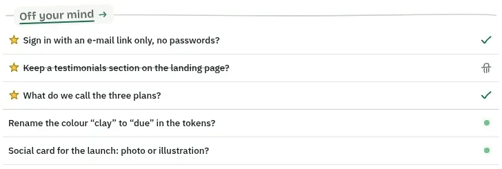

# Changelog

What changed in Trommi, newest first. One section per day; each GitHub release adds the day's release numbers to its heading.

A day starts with one short summary line in headline style ("Star the cards you want to keep. …"), then its lines
under **New**, **Better** and **Fixed**, the most important first. What's new (web and iPhone) shows each line by its
start: up to its first colon, comma or full stop, with a leading "Web:" or "iPhone:" as a tag. When that start says
too little, a line begins with its own short form in bold: `- **Readable addresses**: …`. The newest three days are
open with the first three lines of each part; the rest and older days open with a tap.

A day may have at most one picture, a line `` right
under its summary: a screenshot of the demo room only (`?mock=1`, never real data), webp, at most 150 KB. It shows
small under the summary while the day is one of the newest three.

## 13 October 2026

The App Store listing now opens with your encrypted notes.

**Better**
- App Store listing leads with the encrypted notes screenshot (iPhone and iPad); the others follow in their old order.
- Running agents show as one row of chips under the chat; a line follows its card (snoozed or done cards no longer show as working)

**Fixed**
- Pointing at an option on a card no longer scrolls the picture away (web).

**Fixed**
- Codex connects in a folder where other agent sessions already have keys: connect with an invite link works on the first try instead of answering "Not connected to Trommi. Call the tool again.", and the messages say exactly what to do (an invite in the app, its link given to Codex).

## 12 October 2026

Star the cards you want to keep. Web and iPhone now agree on snoozes, drafts and settings.

**New**
- **New sessions join with one tap**: a new Claude Code session on a machine where another session of the same
  account is on the board asks your Trommi app "Allow new Claude session?" as soon as it starts, in any folder; one
  tap lets it in, no invite link needed. Now on by default (`TROMMI_SELF_JOIN=0` turns it off).
- Star a card (the star beside its close button) to find it again: starred cards stand at the top of Off your
  mind, private and end-to-end encrypted, the same on all your devices (web and iPhone).
- **Connector: one step to a Working on card**: a new tool `start_task` files a "Working on" card and the status line linked to it in one step. The
  card starts under Off your mind as being worked on, not on your Desk and without a notification (web and iPhone);
  when it is revised to "Done: …", it comes to your Desk and the line turns done by itself. Helpers no longer read board events
  themselves: the coordinator forwards them.
- **Invite an agent shows a prompt**: the line to paste is now plain words with the link, "Connect to Trommi with
  this invite link: '…'", which works in Claude Code and Codex even without the slash command; `/trommi:connect`
  stays below it as the other way (web and iPhone).
- **Web: a new Claude session asks in the sidebar**: a session of your own machine that wants to join shows as a
  row where sessions live, with its folder's name, "wants to join · <computer>", Allow and Deny; allowed, the row
  becomes the session.
- **A demo video on trommi.com**: "See how it works", four minutes on the board with sound, right under the top.

**Better**
- **iPhone signs in ten times faster**: a fresh sign-in into a big room (1,000 cards) now takes about 2 seconds instead of 24, as fast as the web. It stores the Desk it reads in one step instead of one disk write per card.
- **Faster start with many archived sessions**: web, iPhone and the connector load only active sessions from the
  hub; an archived session is loaded when you open it, and stays loaded when the app reads the room anew.
- **Calmer hero picture**: the phone on trommi.com and in the README now shows one short yes/no question.
- Web: a new version no longer reloads an open tab while you look at it: a quiet "A new version is ready" offers it, and the tab reloads by itself once it is in the background.
- Web: pictures and previews come from the browser once shown, not from the hub on every open.
- Web: an open tab no longer downloads the whole Desk every minute (about 100 MB an hour in a big room); it asks the hub only what changed.
- Web: a tab opened again is live in under a second in a big room: the Desk is checked with the hub while it catches up, not before.
- iPhone Live Activity with nothing waiting: "All answered" with the working ring and how many agents are at work
  (Dynamic Island and Lock Screen), a tick when none works; it stays while agents work and goes when all is quiet.
- **What's new at a glance**: the newest three days open with a one-line summary, its picture and the first lines of
  New, Better and Fixed; a line opens to its whole text, older days fold to one row with their counts (web and iPhone).
- **iPhone catches up with a fraction of the traffic**: opening the app reads only what changed on your Desk (about 90 KB instead of 4.5 MB in a 1,000-card room), new keys from your other devices no longer make it reread the whole room, and a sign-in with the code reads each session once.
- **iPhone signs in ten times faster**: a fresh sign-in into a big room (1,000 cards) now takes about 2 seconds instead of 24, as fast as the web. It stores the Desk it reads in one step instead of one disk write per card.
- Web: the start page offers "Try the demo" right under Log in, with a line saying nothing is sent.
- Web: a new version no longer reloads an open tab while you look at it: a quiet "A new version is ready" offers it, and the tab reloads by itself once it is in the background.
- Web: pictures and previews come from the browser once shown, not from the hub on every open.
- Web: an open tab no longer downloads the whole Desk every minute (about 100 MB an hour in a big room); it asks the hub only what changed.
- Web: a tab opened again is live in under a second in a big room: the Desk is checked with the hub while it catches up, not before.
- iPhone Live Activity with nothing waiting: "All answered" with the working ring and how many agents are at work
  (Dynamic Island and Lock Screen), a tick when none works; it stays while agents work and goes when all is quiet.
- **What's new at a glance**: the newest three days open with a one-line summary, its picture and the first lines of
  New, Better and Fixed; a line opens to its whole text, older days fold to one row with their counts (web and iPhone).

**Fixed**
- **Helper sessions keep their names on every device**: a helper session whose start one device caught only late on
  a rough network (web and iPhone) now shows its name there too, and one closed meanwhile no longer shows as open (web).
- **New sessions join faster**: when founding a new session's group fails, your device tries again within a second
  instead of after half a minute, and never sends a second founding while the first one waits (web and iPhone).
- **iPhone: a session's link as on the web**: a stream event that says nothing of the link no longer turns a live
  session into "hears you on its next step"; an agent that lost its connection is told on the iPhone too.
- **The red hand matches the Desk**: a session raises the red hand for a question only while that question stands
  on your Desk (web and iPhone); put off, settled on another device or with its agent, it raises none. A session's
  link (on its next step, not listening, cut off) is decided once for both apps.
- **iPhone: agents show online after a fresh pairing**: an iPhone that read the room anew no longer shows every
  agent as offline until it reconnects.
- **iPhone and web read every card and session by one rule**: the board model and its codec are shared by both
  apps; an iPhone sends a board selection as the plain message the web sends.
- **Web: a card you put off comes back when its agent writes again**: Later holds a card only for the version you
  put off; a revision or a raised urgency brings it back to the Desk at once, and its morning brings it back while
  the page stays open. A card on Later no longer raises the red hand in the sidebar.
- **Web: no restart flag**: a session that hears you on its next step no longer asks for a restart with
  `--dangerously-load-development-channels`; board events reach it through the Trommi monitor.
- Web: videos on a Desk row show their first frame, from the middle of the picture.
- trommi.com shows the plain prompt to connect an agent, with the slash command below it, as the invite page does.
- **Pairing in a room with sessions**: "Pair a device" or a reinstall on the iPhone no longer stops with "no
  KeyPackage for a device"; the new device is added to every session as soon as it is ready, also after the app
  was closed. The iPhone now also founds the session of a new agent whose inviter went away.
- **The same sessions everywhere**: iPhone and web list the same sessions in the same order and under the same
  names; an agent paired again in its folder shows once, a closed helper goes to the archive on the iPhone too.
- **New agent online at once**: an agent that joins with `trommi-connector connect` goes online right away under its folder's name, not "gone" under a raw id until its first step.
- **A new agent no longer waits forever for its session**: when the device that tapped "They match" could not found
  the agent's session (an iPhone sent away right after, a tab closed), your web app now does it once the agent is
  connected.
- **No more "Unknown command: /trommi:connect"**: `trommi-connector setup claude` now replaces a Trommi plugin copy
  older than the slash command (Claude Code kept it because the version number stayed the same) and turns the plugin
  on when it was off, in the Claude Code account `CLAUDE_CONFIG_DIR` names.
- **iPhone: cards never vanish while it catches up**: when keys of earlier messages arrived, the iPhone rebuilt its Desk from scratch, showed "Catching up… 0%" with no cards and threw its saved copy away. Now the Desk keeps every card on screen while it rereads, and the saved copy stays until the reread is through, so the next open is instant again.
- **Closed helper sessions free their place**: `close_session` now really ends a helper session (once its open
  questions are answered), so an agent is no longer refused a new one while only a few show on the board. An agent
  may keep up to 100 helper sessions open at once (was 32).
- **`trommi-connector update` replaces a local build**: a connector built by hand and copied over the installed one ("REFUSED as a release" in `--version`) is now replaced by the signed release, also when that release is the newest; before, update said "nothing to do".
- **No more stuck agent after a hub reset or removal**: a session whose key the hub no longer takes (removed, taken over while away, or of a room the hub does not know) now offers `/trommi:connect` again, and a new invite link gets it back on the board without a restart; before, it said to connect and then refused the link.
- **Folders with alike names keep their own keys**: `~/project` and `~/Project` (or `my-app` and `my_app`) no longer share Trommi keys; before, a session in one could see or take the agent of the other.
- **A 64 MB attachment no longer fails with "too-large"**: the connector took files of exactly 64 MiB, which the hub refuses once padded; it now takes up to 64 MiB less one byte and says the limit in bytes before anything is sent.
- **A second window in the same folder can be invited**: when a new Claude Code or Codex session in a folder whose agent belongs to another session was not let in by itself (denied, too many, or self-join off), `/trommi:connect` with an invite link now works; before, the connect tool was missing and refused.
- **A new agent's session no longer stays nameless on one device**: a device that took the session before the agent's arrival in the room showed it without a name and its cards without titles, for good; it now waits for the room and then opens it.
- Hidden Unicode characters can no longer slip into an agent's messages: board text reaching an agent drops
  invisible and direction-changing characters, also the tag characters that spell text no one sees.
- Numbers in settings and card fields keep their exact value when a device writes them again (the last digits
  of a large or long decimal could change).
- **Agents come back at once after a network blip**: the connector waited longer after every cut connection (up to a minute and a half), and its agent showed as away and missed your answers meanwhile; it now reconnects within about a second each time.
- **A session asking to join by itself no longer gives up at a hiccup**: when the session vouching for it was busy reconnecting at that moment, the new session stayed off the board until its next tool call; it now waits for the voucher and gets in after your tap.
- **iPhone: a card answered on two devices at once shows the answer**: when another device answered the same card a moment before this iPhone, the card went back to open here and stayed so; it now shows the other device's answer.
- Web: starring a card no longer shows a line of code for a moment in place of the star.
- A card snoozed on the web no longer stays on the iPhone's Desk: the iPhone now reads the card names the web
  writes, and writes them the same way (drafts, ducks, session and desk settings too; web and iPhone).
- iPhone: a permission request whose time ran out says "expired", as on the web, and one signed in with the code
  no longer misses a helper session that another device added it to first.
- **Web: no flash of closed cards on opening**: opening the app again no longer shows old cards for a moment that were closed on another device; the Desk
  shows only what is open now.
- iPhone: the cards of a session another device let it into no longer stay missing: what an agent wrote there before
  is read from the hub, as on the web.
- iPhone: a short hiccup of the server no longer fails a sign-in with the code: a reading is asked again, as on the web.
- **iPhone: no flash of closed cards on opening**: opening the app no longer shows old cards for a moment that were closed on another device, and a card the
  hub had already closed no longer comes back on every launch; the Desk shows only what is open now.
- **iPhone: helper sessions keep their name**: signed in with the code, a helper session no longer stays without its name: what its agent wrote there
  before the iPhone was in it is read again once the sign-in has joined the session, or once another device hands over
  the keys, as on the web.
- iPhone: the Live Activity no longer shows a bare "0" when everything is answered: it says so, and shows how
  many agents are still at work.
- "The connector needs an update" now says to run `trommi-connector update` (the swap happens by itself), not to update the plugin or run a connect script that no longer exist.
- An agent that went away while your board had lost its connection now shows as gone once the connection is
  back, instead of staying online.

## 11 October 2026

Agents get their own page. Answer from the Lock Screen. Pushes give nothing away.

**New**
- iPhone: a notification shows the question's title, decrypted on your phone. Until the phone was first unlocked,
  or right after a session's key changed, it says "A new question." as before.
- **A new session on a known computer joins by itself**: a new Claude Code or Codex session on a computer and account that already has a connected agent gets onto the
  board with one tap ("Allow new Claude session …?") instead of an invite link and the six emoji, as its own
  session. Its first message says which session vouched for it; at most 8 such sessions per account, and archiving
  one removes its device. The web and iPhone apps answer it now; the connector turns it on in a later release.
- A card its session is working on says so above its title: "<session> is working on it", its status line and how
  long ago, with a running pen line (handed back, or answered while the session works on it; web and iPhone).
- Trommi for Mac: the iPad's layout in a window, the questions waiting in the menu bar, Return sends and
  Shift+Return hands a card back; pairing by pasting the link.
- Settings → Security (web and iPhone) lists every key that opens your data: the account key (your recovery key) with its
  fingerprint, your devices with theirs and the day each came, your agents, and what each of them can read. The self
  test is a row there now.
- iPhone: Settings → Data shows what this iPhone downloaded and uploaded (with a reset), and what your account keeps on
  the hub: messages, cards, files and the total size.
- Settings → Agents shows each agent's plan, e-mail and usage (5-hour window and week, for Codex its credits);
  a session's heading shows the two bars, end-to-end encrypted like the rest.
- Public iPhone beta via TestFlight: join from [trommi.com/beta](https://trommi.com/beta); every release arrives there
  first.
- Settings → Devices names a device of yours that never finished signing in, and removes it with one tap
  (while it is there, new sessions can't be opened).
- iPhone: the Live Activity and Dynamic Island show the most urgent question with its two answers; answer it right
  there, without opening the app.
- The connector updates itself while it runs: no reconnect after an update.
- Drag sessions in the sidebar into your own order; the iPhone shows the same order.
- Delete your account right from the iPhone app (Settings → Account).
- Log out straight from the desk menu.
- What's new in the desk menu (web and iPhone): this list, with a dot until you have read the newest day.
- Settings → Agents (web and iPhone): each agent as Claude Code or Codex on its computer, its sessions under it; remove an agent from there. Devices lists only your phones, tablets and browsers.
- Codex hears the board: a new answer or message wakes an idle Codex session, which then reads it.
- What's new tells each day in a few sentences, with a picture; all of its changes unfold under "All changes" (web
  and iPhone).

**Better**
- A session's heading is one line: the name, its connection as a dot (what it is at, model and machine in its tip),
  All | Questions beside it, and its usage as one mark of two rings, the week outside and 5 h inside (web and iPhone).
- A session shows a switch "All | Questions" under its heading, with the number of questions waiting; the funnel beside
  the message field is gone (web and iPhone).
- A session's heading is calmer: under the name a dot, what it is at and its model; its usage (5 h and week) as two
  small rings at the right, beside the ⋯ on a phone; its files moved into the ⋯ menu.
- On an opened question ← → step through its pictures and never switch questions; Shift ↓ ↑ go to the next or
  previous question (web).
- A question's options explained stand at the end of the card, after the pictures, all open; the pointer on an
  answer marks its text and the pen's arrow points at it (web; iPhone lists them at the end too).
- The reverse card on a card: its black oval smaller, with air above and below, as on the send button (web and iPhone).
- Desk: the headings "Off your mind" and "Artifacts" are links themselves, underlined with an arrow; no separate "Show more" (web and iPhone).
- A helper's status line follows its question: filing a card turns the line to waiting on you with that card, and
  your answer turns it back to working with what you chose; no more lines that still wait after you answered.
- Agents answer a request or question you write in chat with a card (an info card for results, a decision card for
  choices) instead of only a chat reply.
- Less for anyone between you and your devices: every push says the same ("Something new.", your iPhone shows what it
  is); the Live Activity's updates from the hub say only whether agents work and whether something waits (the app
  shows the numbers); the hub sees only whether a card knocks, not its urgency, and no longer when you answered;
  messages and new files are padded to fixed sizes.
- iPhone: a notification makes the app open almost up to date (what it brings is fetched ahead, still encrypted),
  and the Live Activity shows the real numbers again, sealed for your phone alone.
- iPhone: right after you log in, the Desk shows the open questions from the hub's list, before the history is read.
- Off your mind: an answered or done card has a green tick on the right, a shredded one a shredder (and stays struck through), a withdrawn one a return arrow (web and iPhone).
- Web: coming back to the tab after a while, or getting the network back, reconnects at once; new cards no longer
  wait up to a minute behind a connection the sleeping phone left half open.
- Pairing a device or an agent survives a network blip: a step that did not reach Trommi is tried again, and if it
  still fails you are told it was the connection, with "Try again" on the same code instead of asking for a new one.
- What's new says what runs: at its top the release, its build and when it was updated (web; on the iPhone the app's version and build).
- Helpers read their own board events: a subagent's child session goes to it directly, so the main agent no longer
  passes them on; it gets one line when the helper is done, and the events back if the helper stops reading.
- Codex as Claude Code: `setup codex` adds Trommi's hooks to Codex, so its terminal, its answers (under the card
  they belong to), its permission prompts and its work trail reach the board too, once you trust the hooks in Codex.
  `trommi-connector remove codex` takes them out again. A Codex with its own `CODEX_HOME` is woken too.
- Codex: a session that was woken but did not read the board is woken again by the next message (at most every
  3 minutes); it answers a card's question under that card; restart and "key in use" messages speak Codex's language
  instead of Claude Code's.
- iPhone: after another device of yours hands over older keys, the app no longer empties the Desk and reads the whole
  room again: what it has is kept, only what was missing is read (about fifteen times faster).
- Status lines under a chat: the time short with a small clock after it ("4m"); on the phone one line each, the title and the time, and a tap shows the detail and the way to its question (iPhone and web).
- Logging in on the web checks only your account's own history before it opens; each conversation is checked
  right after, in the background.
- Long chats open on the last day and load further back as you scroll up; this browser keeps only the newest
  500 messages of each chat and reads older ones again when needed.
- iPhone: logging in to a big account opens the Desk at once and fills it page by page, with "Catching up… N%";
  catching up is about ten times faster (one write per page instead of one per item).
- iPhone: big boards stay smooth while news comes in: a change of the board costs a fraction of before, a long chat
  opens three times faster with its newest 150 messages ("Earlier messages" shows more), swiping back from a chat no
  longer stutters, and a huge desk needs a fifth of the memory.
- When an agent answers something you asked on a card, its answer stands in that card's thread; the chat shows one
  line pointing to the card.
- The website shows the apps: the web app and the iPhone app in real screenshots, light and dark.
- trommi.com reworked: a light head with Trommi, Apps, Agents and the GitHub mark, the picture right under the
  headline, Web, iPhone and Mac side by side, and a section on the agents and how to connect one.
- trommi.com: headline at the left and the laptop and iPhone at the right in the first view; Apps as whole cards;
  Agents with a terminal holding the three steps to connect one.
- The reverse card's middle is now an oval drawn by the pen, a little uneven and tilted (web and iPhone).
- The writing field under a card is calmer: one "+" on the left for attaching and drawing, Send on the right. Shift+Enter hands the card back with your words, Alt+Enter (⌥+Enter) starts a new line (web; on the iPad with a keyboard too).
- The demo looks calmer and friendlier: sessions with plain names, design choices with pictures first, one urgent card
  instead of a stack of red ones.
- **Settings: Invite a Device and Invite an Agent side by side**: Invite a Device and Invite an Agent stand side by side as equals; Devices and Account are laid out
  like the rest of Settings, each device and each way in (password, passkeys, Emergency Kit) with its own page.
- An agent reporting on an ongoing matter keeps one card and updates it, with the newest state in the title.
- An agent you ask for something keeps one card for it, from Working on to Done.
- A main agent coordinates: cards about a topic (design, iOS, release …) sit in that helper's session, so your
  answers go straight to the helper working on it.
- The self-test screen is now called "Security Info".
- Settings → Account no longer has the "Advanced" block with the old account address; the old recovery-code screen (/recover) is gone. Room, key epoch and hub are shown under Security Info.
- Codex: the board tools are there from the start, Trommi tool calls no longer ask for approval one by one, and the texts say to restart Codex (not /mcp) when needed.
- A Codex session between turns shows as "on its next turn", never as gone or not listening.
- **A running status line opens its card**: in a conversation, a running status line opens the card it works on, the same card its row on the Desk opens
  (web and iPhone).

**Fixed**
- **Web: a new browser in a long room is live in seconds**: signing in on a new browser in a room with a long history is live in seconds again, not after a minute.
- Desk: a row no longer grows when the pointer rests on it; the text under the title stays hidden (web).
- **Web: no old approvals while signing in**: signing in on a new browser: the Desk no longer shows old, empty approvals or "Go outside." while your room is
  still being read. It says "Catching up…", open questions show as quiet "Loading …" placeholders until they are
  decrypted, sessions are "Loading …" instead of an id, and agents show as connected right away instead of "gone".
- Web: a permission request that was answered or ran out on another device no longer stands on the Desk as open.
- A second Claude Code or Codex session started in the same folder no longer writes into the first one's board
  session: each session is its own agent and needs its own invite; only resuming a session continues it.
- Web: a picture that could not be loaded keeps its place as a small tile (the reason on hover); a Desk row keeps its
  title and answers in view. An open tab looks for a new version every 10 minutes, and at once on a file of a newer Trommi.
- Web: a card handed back and then put before you again no longer slips back to "with the agent" (off the Desk)
  when you open it; a card already stuck that way returns to the Desk by itself.
- After /mcp → Reconnect a connected agent no longer shows as gone: the old connector's goodbye can't override the new one's hello.
- iPhone: the app no longer crashes when it starts with an account already signed in.
- A card you put off (Later) wakes up when you answer it or hand it back with the reverse card: reworked, it is back on the Desk (web and iPhone).
- iPhone: a session renamed on another device no longer shows up twice; the new name lands on the session itself.
- **Web: no more "Connecting" after catching up**: after catching up, the app could keep saying "Connecting" although it was connected and up to date.
- Open cards are the same on every device: the web takes them from the hub's list of open questions, so a card
  settled elsewhere no longer stays on the Desk, and a card put before you again no longer hides under "Off your mind".
- Renaming a session on the web no longer makes a second session appear on the iPhone.
- Web: an answer to a form that came only after you had moved to another page (a removed device, say) no longer
  takes you away from that page.
- Logging in on the web reads a big account several times faster, keeps saying how far it is, and a log in that
  was given up no longer leaves this browser stuck on "Not opened": logging in again works.
- iPhone: the Dynamic Island shows only while a question waits (no more "0"), and its bell no longer jumps on every
  update.
- Web: a message to a session that still held a removed device ("Not sent: stale-session") now goes out: the
  session is repaired first and the message is sent again.
- iPhone: "N new" in a chat goes away once you are at the end or see the newest message.
- iPhone: decisions answered, read or closed on another device no longer stay on the Desk as open questions, also
  while the phone catches up.
- iPhone: logging out no longer crashes the app.
- Opening a session no longer fails when one of your devices has been away for long: it joins the session when it comes
  back.
- Web: logging in to a big account shows how far it is ("Catching up … of …"), opens before every session is
  joined, and a stuck login stops with a message instead of spinning.
- iPhone: logging in to a big account no longer hangs at "Logging in…": the button shows how far it is, the
  sessions join after you are in, and a stuck login stops with a message.
- Opening Trommi after a long time away: questions answered elsewhere no longer show up as open while it catches
  up, and logging in on a new browser is ready in seconds instead of a minute.
- Web: the number keys 1, 2, 3 … switch the desk without opening the desk menu, which then blocked the next key.
- A device that missed the keys for older content now asks your other devices for them, even weeks later.
- **Changing a password or key asks for proof**: changing your password, Emergency Kit or passkeys now asks for proof that you know a current one:
  being logged in is not enough.
- A phone added to a running session could show the agent's raw id instead of its name.
- The iPhone app could crash while sending.
- **Logging out forgets the local key**: after logging out, the browser kept the key that had protected its local data.
- Every agent session showed "hears you on its next step" (and later "not listening") even when it heard the board at once.
- Codex no longer tries to start Trommi through a script when its tools are missing; it tells you to restart Codex.
- The web app on phones: Settings pages fit a small screen (password, passkeys, the device fingerprint shown whole),
  the ••• of a chat is no longer under the page corner, the tab bar is solid and stands beside the page in landscape,
  nothing sits in the home-indicator strip, fields no longer make iPhone zoom in, long answers stay inside their
  buttons, the invite commands break at sensible places, and Artifacts has its heading again.
- A note of only a pasted picture, folded right after the paste, is no longer thrown away.

## 10 October 2026

One encryption core everywhere. The connector installs with one line. A new demo room.

**New**
- Trommi now runs on one Rust core built on OpenMLS, the same code in the web app, the iPhone app
  and the connector. Everything on your board stays end-to-end encrypted.
- One line installs the connector for Claude Code and Codex: a single signed program, no Node needed.
- Inviting an agent takes three short steps, each line ready to copy.
- Sign in with your e-mail or your account id; "All my devices are lost" restores your account
  from the Emergency Kit.
- Every release is signed, and every account starts with a desk of its own.
- A new demo room with two desks to look around in before you sign up.
- Readable addresses: `/chat/<id>` and `/artifact/<id>`.

**Better**
- "New Agent…" makes a fresh link each time; the previous unused link stops working.
- Logging out never hangs, even on a slow connection.

**Fixed**
- The invite page showed the same short link for every agent.
- A corner note with only pictures could not be sent.
- Deleting a session failed with "ids is not defined".
- The demo's Desk and Scribble Board no longer spin forever.

## 9 October 2026

Goals for each desk. The connector on macOS. Live Activities on the iPhone.

**New**
- Live Activities on the iPhone keep what waits for you in view; pushes carry the card's title.
- Links to Trommi open in the iPhone app.
- The connector runs on macOS too and keeps its key in the Keychain.
- Write goals for a desk; they stand under the greeting.
- Duck it and Blitz work on info cards too.

**Better**
- "Off your mind" is a plain feed of what is done; "Archive" replaces the tick box.
- Copying an artifact's link shares it for 30 days, without a dialog.
- A calmer iPhone app: a chat list like Messages, floating glass buttons, attachments inside the composer.
- Dark mode keeps dark ink on the paper and quiet frames.

**Fixed**
- Long strokes on the Scribble Board no longer slow down the pen.

## 8 October 2026

The iPhone app is here: Desk, chats, notes and the Scribble Board, with push.

**New**
- The iPhone app: the Desk, chats, notes and the Scribble Board (with Apple Pencil),
  signed in by QR code or with e-mail and password.
- Push notifications on the iPhone, and a choice per device: all, only knocking, or none.
- Share from any iPhone app into Trommi; it arrives as a note.
- Artifacts: media and pages together in one place.
- Light, Dark or System theme.
- Each option on a card can carry its own picture.

**Better**
- The app starts faster and stays smooth in big rooms; the heavy work runs in the background.
- On a phone the web app has a menu pill and a tab bar instead of the sidebar.
- "Off your mind" gathers finished and handed-out cards in one list.
- Content from a newer Trommi shows a calm placeholder in an older app instead of breaking it.

**Fixed**
- Keys no longer stop working on the Desk after a visit to the Scribble Board.
- Nothing scrolls sideways on a phone.

## 7 October 2026

Calmer on a phone. Six emoji to connect an agent. Blitz for rapid answers.

**New**
- On a phone the sidebar is a drawer.
- Compare six emoji when you connect an agent, instead of picking a number.
- Delete a session from its menu.
- A third pile on the Desk for links and pages.
- Full screen for a card, and a tracing sheet to draw over the whole card.
- Read earlier versions of a card right in its thread.

**Better**
- Rapid fire is now Blitz, with a lightning bolt.
- "Got it" instead of "Acknowledge" everywhere.
- Tap targets on a phone are a finger's size.
- The advised option leads a row; every answer tile has the same size.

## 6 October 2026

Hand a session on. Duck it answers everything at once. Later puts a card off.

**New**
- Continue a session: hand it to a new agent, with or without its history.
- Duck it: answer every open decision on the Desk at once with "whatever you think".
- A greeting at the top of the Desk.
- Drag the corner note onto the Scribble Board and leave it there as a sticky.
- Later is a tag under the card: pull it down to put the card off.

**Better**
- Inviting an agent is a small clipboard with the command to copy.
- Cards are as long as their content, and the page scrolls.
- Arrow keys walk a card's answers.
- The demo speaks English.

**Fixed**
- Two connectors in one folder no longer fight over the key: it follows the session in use.

## 5 October 2026

Permission prompts reach the board. Each desk shows only its own sessions.

**New**
- Permission prompts from Claude Code reach the board, and leave it once answered in the terminal.
- When auto mode blocks a tool, the session says so in one quiet line.
- Move a session to another desk from its own page.
- The page turns from its top-right corner between the Desk and the Scribble Board.

**Better**
- A desk shows only what its own sessions hold.
- The note is back as a yellow sticky in the bottom-right corner.

## 4 October 2026

End-to-end encryption. Accounts, QR pairing, the Scribble Board and a new Desk.

**New**
- End-to-end encryption: the hub stores only sealed messages, and only your devices can read them.
- Accounts with e-mail and password, an Emergency Kit, and login on a new device.
- Pair a device by QR code.
- The connector as a Claude Code plugin, set up on any machine with one command.
- Share a file with someone outside your room through a private link.
- Videos on cards.
- The Scribble Board, notes with attachments and a media gallery.
- Agents can open helper sessions of their own.

**Better**
- The Desk redesigned: drawing, urgency, teaser, pictures and square answer tiles in one row;
  finished items move to a single pile.
- Infos sit apart from the questions as a short checklist.
- Switch desks with the keys 1 to 9.
- Several tabs of the app work side by side.

**Fixed**
- The phone no longer loses its login.
- Agents keep working through a hub restart.

## 3 October 2026

Push notifications.

**New**
- Push notifications and the bell icon.

## 2 October 2026

The first board: your agents ask, you answer with a tap.

**New**
- The first board: an inbox of questions from your agents, with sessions, a canvas and dictation.
- Answer tiles, the agent's advice circled by hand, and questions agents can revise or merge.
- Agents can publish pages and files to the board.
