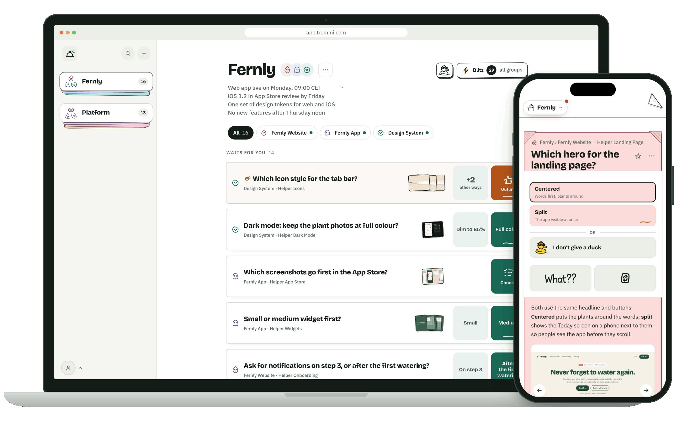
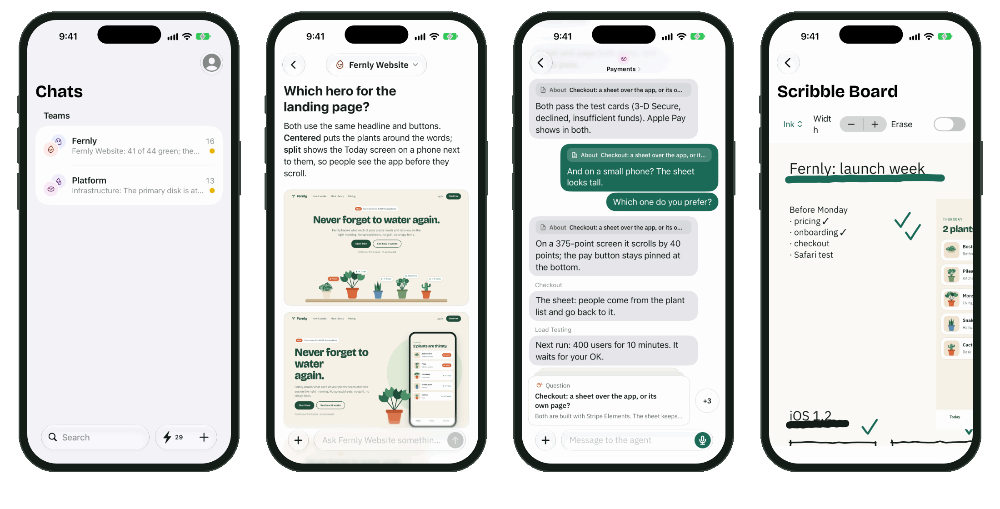
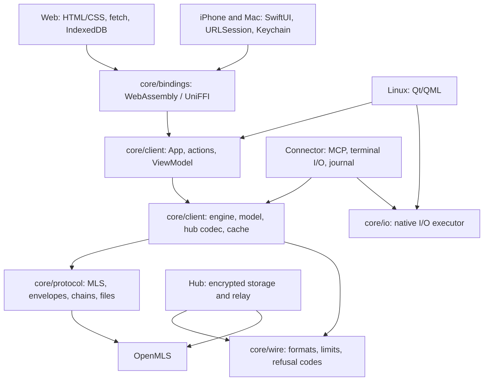
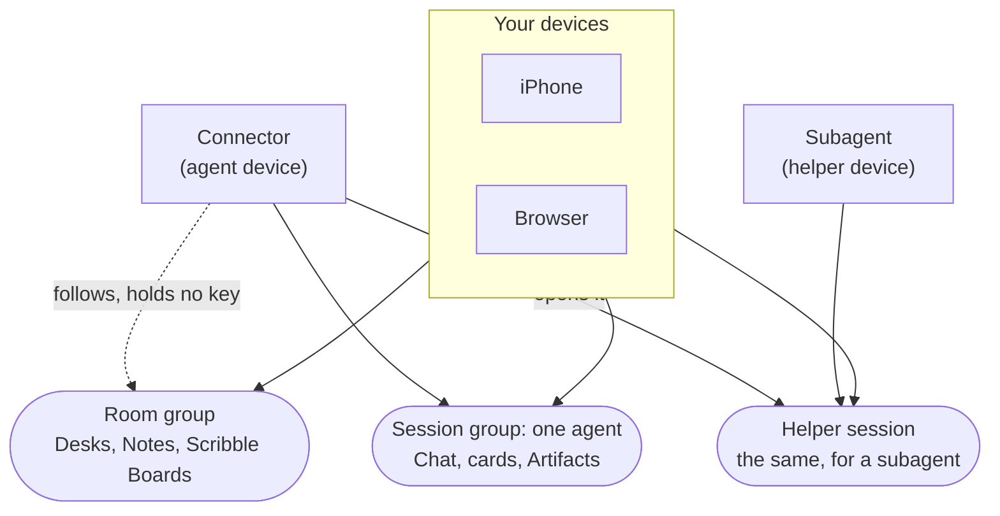
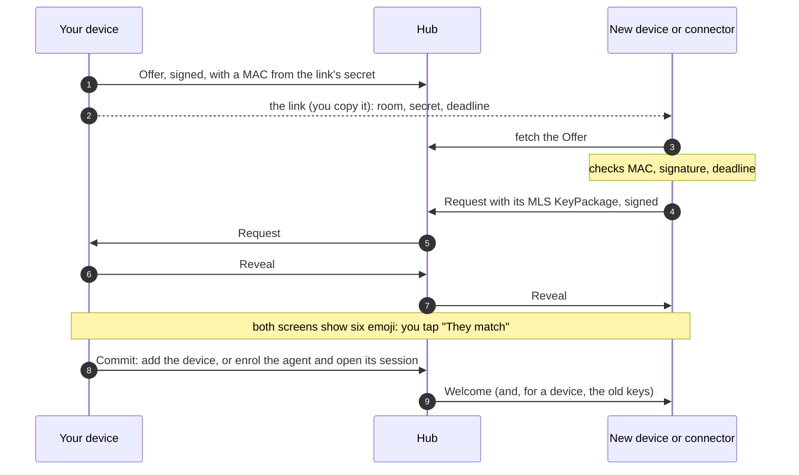
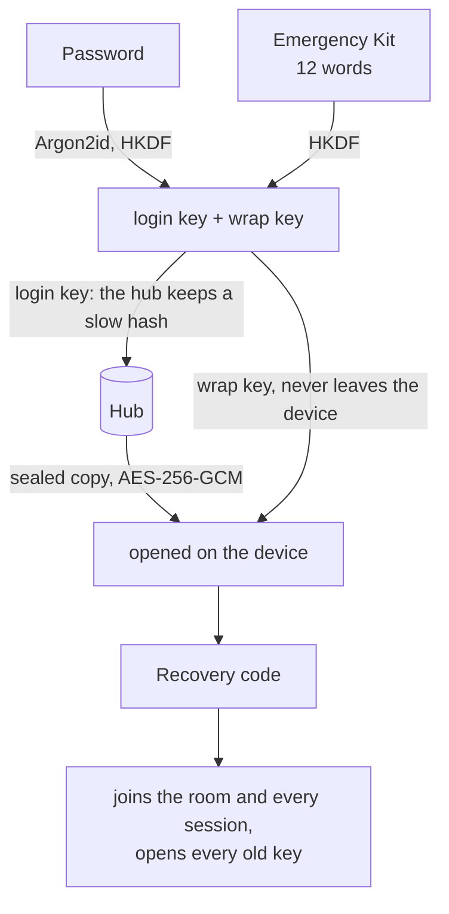
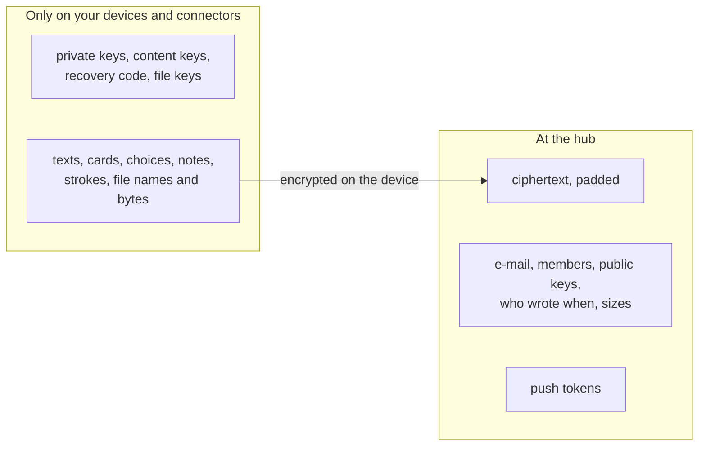
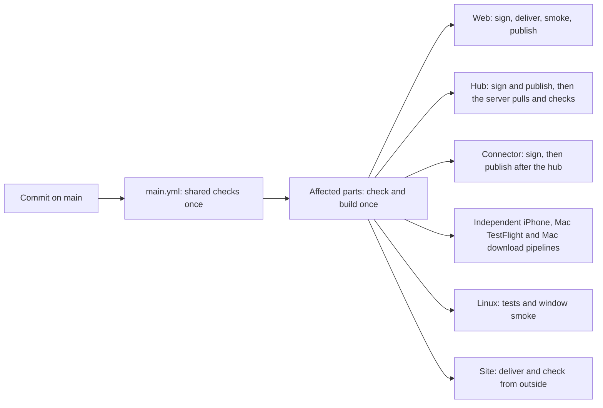
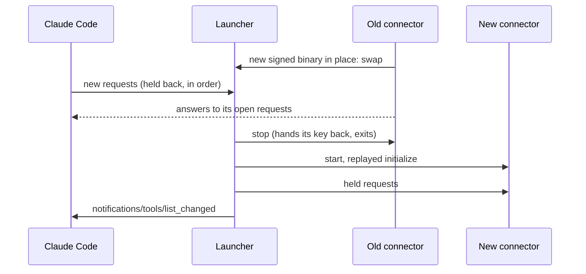

# Trommi

**Your agents ring. Answer anywhere.**



Your Claude Code and Codex sessions ask, you answer: chat, decision cards and a Scribble Board, on the web and on
the iPhone. Everything is encrypted on the devices with MLS (RFC 9420); the server only passes sealed messages on.
One Rust app core runs the web, iPhone, Mac, Linux and connector; the platform shells draw and perform I/O.

- 💬 **Chat** with every agent session, the terminal mirrored
- 🃏 **Decision cards**: the agent asks, you tap an answer
- ✏️ **Scribble Board**: draw, write, stick notes, send them to an agent
- 🗂 **Desks** to sort your agents, with their helpers under them
- 🔒 **End-to-end encrypted**: the server never holds a key or reads content



<sub>Desk · Card · Chat · Scribble Board, from the made-up demo room (`demo/`).</sub>

**[→ Open Trommi](https://app.trommi.com)** · **[▶ See how it works](https://trommi.com/#demo)** (a four-minute video)

## Install

1. **The app:** [app.trommi.com](https://app.trommi.com) in any browser. On an iPhone: the public beta on
   TestFlight, [trommi.com/beta](https://trommi.com/beta) (every release of main; the App Store gets reviewed versions
   less often).
2. **An agent**, on a Linux or macOS computer with Claude Code or Codex. Once per machine:

   ```sh
   curl -fsSL https://raw.githubusercontent.com/chriopter/trommi/main/install.sh | sh
   ```

3. In the app: **Approve a computer**. In the project folder start `claude` (or `codex`) and paste the line it shows:

   ```
   Approve this computer in Trommi with this invite link: '<link>'. Call the Trommi connect tool with this link and computer=true.
   ```

   In Claude Code the plugin's slash command does the same: `/trommi:connect --computer '<link>'`. Claude Code asks once
   whether to use the trommi MCP server: choose "Use this MCP server". Six emoji appear in the terminal and in the
   app; tap "They match". Later sessions stay off the board until you run `/trommi:connect` without a link
   (or ask Codex to connect). An online Trommi app answers; no other agent session needs to be running.

Updates come by themselves: a running connector installs a new signed release and swaps it in, no restart and no
/mcp → Reconnect. By hand: `trommi-connector update`.

## How it works

- **Room:** everything of one account, shared by all of your devices.
- **Sessions:** each agent session is its own encrypted group: your devices and that agent, nobody else.
- **Hub:** the server stores ciphertext and who is in which group, and pushes to your devices. It cannot read a
  message, a card, a file or a key.
- **Connector:** one signed program that joins a Claude Code or Codex session to your room.
  What the agent is told: [connector/prompt.md](connector/prompt.md).



App logic exists once, in Rust under `core/`:

- `core/client/` (`trommi-client-core`): account flows, hub synchronization, history, actions and echoes, the board
  model, cache, notifications, share imports, and every screen's ordered ViewModel. The human apps run `App`;
  the connector runs its shared `Engine` in agent mode and reads the shared model.
- `core/protocol/` (`trommi-core`): MLS, envelopes, chains, the command gate, encrypted files, keys and protocol rules.
- `core/bindings/{wasm,swift}/`: one facade for the browser and Swift. `AppCore` exchanges events and effects;
  generated view types and folds keep both platforms on the same contract. Rust hosts use the crates directly.
- `core/io/` (`trommi-io`): the Rust executor for HTTP, raw event streams, stores, timers and the device-write barrier,
  used by Linux and the connector. It makes no app decisions.
- `core/wire/` (`trommi-wire`): formats, refusal codes, route limits, envelope framing and pure membership checks shared with the hub; no keys or I/O.

The apps draw the core's view state, pass taps and focus back, and perform platform services: fetch or URLSession,
IndexedDB or an encrypted journal, push, notifications, Keychain, file pickers, Live Activities and the share sheet.
They keep no second board model or sync implementation, and do not sort lists or decide state-dependent words.
The connector's driver adapts the same engine to MCP and its journal; its computer-key locking and platform I/O remain
in the connector. The hub checks public group changes with OpenMLS and `core/wire`; it holds no content keys.
The contract and platform boundaries are described in [The app core](core/client/README.md).

## Under the hood

<details>
<summary><b>Encryption</b> · MLS, one suite, one Rust core</summary>

- **MLS** ([RFC 9420](https://www.rfc-editor.org/rfc/rfc9420)) hands out every key, with
  [OpenMLS](https://github.com/openmls/openmls) `=0.9.1`.
- **One suite**, no negotiation: `MLS_128_DHKEMX25519_CHACHA20POLY1305_SHA256_Ed25519` (X25519, ChaCha20-Poly1305,
  SHA-256, Ed25519).
- **One Rust core** (`core/protocol/`, the crate `trommi-core`) does all of it: as WebAssembly in the browser, through UniFFI
  on iOS, natively in the connector. The hub checks group changes with OpenMLS itself and holds no keys. There is no second implementation.
- **A device is its key:** one Ed25519 key per device, made on the device; private keys never leave it.
- **Content** (chat, cards, notes, board items) is stored as signed envelopes, encrypted under a content key that
  MLS exports per group and key period. **Files** get a random key of their own each, sent inside the encrypted
  message that names the file.
- **History is readable by your devices, by decision:** a new device of yours gets the old keys and reads
  everything, and so does the recovery code. That is not forward secret for history. A copied device state opens
  nothing new after that device's next update (your devices update about once a week) or its removal.

</details>

<details>
<summary><b>Rooms, sessions and devices</b> · who is in which group</summary>



- **Room group:** all of your devices (at most 1000) and nothing else. It protects what belongs to you, not to one
  agent: Desks, Goals, Notes, Scribble Boards.
- **Session group:** one per agent session: your devices and that agent's connector. One agent never reads
  another's session, and no agent reads the room group.
- **Helper session:** a subagent's own group, opened by its agent's connector, with your devices in it.
- Which Desk an agent sits on is only a value inside the room group: moving it changes no key.
- **Removing** a device or agent takes it out of every group at once, and the hub ends its access.

</details>

<details>
<summary><b>Joining a device or an agent</b> · a link and six emoji</summary>



- The **secret** is only in the link; the hub never sees it. The MAC ties the Offer to the link, so a hub cannot
  serve an Offer of its own.
- The **deadline** is in the link and in every key the secret gives: 10 minutes for a device, 15 for an agent.
  A link is used once; "They don't match" burns it.
- The **six emoji** (36 bits) are computed from everything exchanged, the new device's KeyPackage included. Nothing
  is added before you confirm them; this is what stops a hostile hub from slipping in a device of its own.
- **Signing in** on a new device with your password needs no emoji: the recovery code is the authority
  (Account and recovery, below).

</details>

<details>
<summary><b>Account and recovery</b> · password, recovery code, Emergency Kit</summary>



- Every room has one **recovery code** (32 random bytes). The account holds it only sealed: one copy under your
  password (Argon2id, 64 MiB, then HKDF and AES-256-GCM), one under the Emergency Kit's 12 words.
- The hub never sees the password, the words or the code. It keeps a slow hash of the login key and refuses to
  remove the last way in.
- With the code a new device joins the room and every live session, and opens the content key of every group and
  key period, which each change seals to the recovery key at the hub (HPKE). A MAC that only your devices can make
  ties those copies to you, so a hub cannot hand you a history of its own making.
- **Emergency Kit:** the 12 words and your account ID, to print. **Nobody can reset an account**: without password,
  kit and devices the content is gone.
- Wrong passwords slow the source down; there is no lockout. **Passkeys** are built and off for now.
- After you remove a device that is not in your hands, the app asks you to replace the code.

</details>

<details>
<summary><b>What the hub sees</b> · and what it cannot</summary>



| The hub reads | The hub cannot read |
|---|---|
| your e-mail, a slow hash of your login key | password, Emergency Kit words, recovery code |
| who is in which group, their public keys, every group change | any private key or content key |
| per stored item: sender, group, time, kind, a card's state and whether it knocks, the padded size | every body: texts, titles, options, choices, a card's urgency, when it was answered, strokes |
| files: id, padded size, uploader | file bytes, names, types, keys |
| per Scribble Board: when a snapshot was written, up to which item it reaches, which files are still on it | the shapes, what was erased |
| push endpoints and tokens | nothing: every push looks the same ("Something new."), its room and urgency are sealed for the device |

- The hub checks every MLS change it can check in public and refuses a device that was not invited.
- The hub keeps only what is still needed: a writer's older register values and Note versions, board items behind every device's snapshot, and objects settled 30 days ago lose their bodies; strokes being drawn are passed on and never stored.
- The whole table per stored thing: [`spec/v1.md`](spec/v1.md), section 14.

</details>

<details>
<summary><b>Signed releases and deployment</b> · each part on its own</summary>



- **One workflow on main** ([`main.yml`](.github/workflows/main.yml)) plans affected parts, runs the shared core's
  checks once, and uses the same `check-*` actions as pull requests. Each releasing part has its own
  [`main-part.yml`](.github/workflows/main-part.yml) check/build job and independent delivery destinations in
  [`main-delivery.yml`](.github/workflows/main-delivery.yml). One part failing does not prevent another passing
  part from delivering. The direct Mac download does not wait for TestFlight processing.
- Delivery compares each part with what it actually has out there, so an earlier failed delivery is retried.
  Check baselines also advance per part as soon as its checks pass, even while another delivery is still running.
  README edits are not build inputs. Native bindings reuse the host static archive already built for UniFFI.
- Release-key commands run in jobs that never execute a built app or connector. Before signing or publishing,
  the gates verify actual GitHub job conclusions and artifact digests exported through the producing jobs' outputs;
  an artifact with the right name alone is insufficient. Per-part publication/delivery locks, signatures,
  attestations, rollback, outside smoke and TestFlight processing/groups remain in force.
- Graph examples, with releases needed and no earlier undelivered parts: web-only **11 → 6 checks**;
  shared core **54 → 19 checks**. Only affected part rows expand. When all parts need only checks or all need
  delivery, GitHub shows one skipped aggregate for the empty class; a shared-core change uses both classes.
- **Manual recovery:** `ship-web.yml` still replays a checked web artifact, and `ship-apple.yml` retains TestFlight replay and the manual App Store gate. Both old `ship-*` runs and
  new `main` runs are accepted only after their source and checks are verified. The connector, Linux and site
  manual entry points dispatch `main` with that part selected. Hub recovery reruns its checked `main` delivery. `main` itself can also be run manually.
- The new release number is `2000 + main's run number`, above all earlier series when introduced; retries keep
  their number. TestFlight continues to allocate its build numbers through App Store Connect.
- The hub and the connector have **their own signed release series**, `hub-v<N>` and `connector-v<N>`: one
  `manifest.json` each (each file's size and SHA-256), signed with Ed25519. Public key:
  [`release/public-key.pem`](release/public-key.pem); the private key lives in 1Password. A connector release waits
  until the server runs the hub of the same commit, when that commit delivers both.
- **The web app** gets a release `web-v<N>` too, once it is delivered: its release notes and `web.tar.gz` as it went
  out, signed and attested (the record of what went out and a build to put back; no browser checks it).
- **Release notes** come from the pull requests: each PR's section "What's new" (`.github/pull_request_template.md`,
  lines starting `New:`, `Better:` or `Fixed:`; empty for internal work), else its title. A part's release lists the
  PRs merged since its release before that touch its paths (`.github/scripts/release_notes.mjs`,
  `inputs.sh paths <part>`). What's new on the web and the iPhone is read from these notes: the web app's worker
  serves `/whats-new.json` (`app/web/whats-new.mjs`) from GitHub's public releases API, unauthenticated (a token
  only if the secret `GITHUB_RELEASES_TOKEN` happens to be set), fresh for ten minutes in Cloudflare's cache and the
  last good list served on any GitHub error or rate limit; beside it the one summary a day (and at most one picture)
  in `app/web/public/changelog/CHANGELOG.md`, and the days before in `history.json` there (frozen).
- **The iPhone and Mac apps** (`main.yml`) go to TestFlight when their checks passed and their inputs differ
  from those last delivered there; then `ios-v<N>` records what changed for them (notes and the TestFlight build, no
  file). The Mac app for direct download is `mac-v<N>`.
- **The hub:** checked binaries become an image signed with a separate Cosign ECDSA key; binary manifests keep their Ed25519 key. Only then
  does CI promote its deployment tag and send an empty authenticated POST to YoloDeploy. The fixed target verifies
  the digest, waits for Docker health. A failed start returns to the previous image on current data; migrations must stay
  compatible, and regular verified backups run separately. CI also verifies the public hub's exact
  commit. See [the container flow, self-hosting and recovery](hub/container/README.md).
- **The web app** cannot be signed for a browser: every file it serves carries a GitHub build attestation.
- Pull requests get no secrets and deploy nothing.

Check a release, and a file the web app serves:

```sh
release/sign.sh verify manifest.json   # the signature
release/sign.sh files manifest.json    # each file against the manifest

curl -fsS https://app.trommi.com/index.html -o index.html
gh attestation verify index.html --repo chriopter/trommi
```

The current container flow and its limits: [hub/container/README.md](hub/container/README.md). The older binary
updater and data layout remain documented in [hub/deploy/README.md](hub/deploy/README.md).

</details>

<details>
<summary><b>Mac app (direct download)</b> · Developer ID, notarized, on every release</summary>

The Mac app (the target `TrommiMac`, [app/ios/README.md](app/ios/README.md) "Xcode, TestFlight and releases") ships two ways: TestFlight
and the Mac App Store as before (the manual gate in `ship-apple.yml`), and as **`Trommi-macOS.dmg`** on the GitHub release, outside the
store. The newest is always at
[releases/latest/download/Trommi-macOS.dmg](https://github.com/chriopter/trommi/releases/latest/download/Trommi-macOS.dmg)
(Apple silicon, macOS 26).

[`.github/workflows/main-delivery.yml`](.github/workflows/main-delivery.yml) (the `mac-direct` destination), on a
push to main that changed the apps:

1. **Whether it builds** (`.github/scripts/mac_release.sh check`): the commit's iOS inputs (the Mac app is built from
   the same paths as the iOS app) differ from those of the newest Mac app released; and the checks passed.
2. **Built:** on a Mac runner the Rust core for the Mac, then
   [`.github/scripts/mac_direct.sh`](.github/scripts/mac_direct.sh): archive (build number = the build's number N),
   export with method `developer-id` (the team's Developer ID Application certificate, hardened runtime, Xcode's
   Developer ID profile for push and associated domains), checked (authority, the very certificate, runtime, secure
   timestamp, entitlements of `TrommiMac.entitlements`, no `get-task-allow`), notarized with `notarytool`, stapled,
   accepted by Gatekeeper; then the `.dmg` (the app and a link to Applications), itself signed, notarized, stapled.
3. **Released** as `mac-v<N>`, marked latest: `Trommi-macOS.dmg`, `Trommi-macOS.dmg.sha256` and `Trommi-macOS.json`
   (release, commit, iOS inputs, SHA-256, size), each with a GitHub build attestation. A file already released is
   never replaced.
4. A failed build or release opens the issue "iOS build <N> failed" (the run's report).

The `.dmg` is in no `manifest.json` signed with the release key. What vouches
for it: Apple's Developer ID signature and notarization, which macOS checks before the first start, and the build
attestation. Check a download:

```sh
shasum -a 256 -c Trommi-macOS.dmg.sha256
gh attestation verify Trommi-macOS.dmg --repo chriopter/trommi
spctl --assess --type open --context context:primary-signature -v Trommi-macOS.dmg   # source=Notarized Developer ID
```

**Fails closed.** Without the environment `mac`, or without the certificate or the App Store Connect key in its
1Password Environment, the job ends green with a notice and nothing is attached; no unsigned or un-notarized app is
ever published. A build on any Mac without secrets (signed ad hoc, the same checks, Gatekeeper must refuse it):
`core/bindings/swift/build.sh macos`, then `.github/scripts/mac_direct.sh adhoc`.

**Set up once** (owner):

1. Apple Developer → Certificates → **+** → **Developer ID Application** (G2 Sub-CA), with a CSR from Keychain Access
   on a Mac (only the Account Holder may create it). Install it, then in Keychain Access export the certificate
   **with its private key** as a `.p12` with a strong password.
2. A 1Password Environment for the Mac (not the `ios` one, so only this job sees the certificate) with:
   `APPLE_DEVID_P12` (the `.p12` in base64: `base64 -i DeveloperID.p12 | tr -d '\n'`), `APPLE_DEVID_P12_PASSWORD`,
   and the App Store Connect key as for TestFlight: `APPLE_ASC_KEY`, `APPLE_ASC_KEY_ID`, `APPLE_ASC_ISSUER_ID`,
   `APPLE_TEAM_ID`. The key's role (Admin) is enough for `notarytool`; no app-specific password is needed.
3. The Developer ID profile (push and associated domains need one): CI fetches it with the App Store Connect key and
   makes it when it is missing (`asc.py devid-profile`). Should Apple refuse that, make it once by hand:
   developer.apple.com/account/resources/profiles/add → Developer ID → App ID `com.trommi.ios` → the certificate of
   step 1 → name "Trommi Mac Direct" → Generate; nothing to download or store, the next run finds it.
4. GitHub → Settings → Environments → **New environment `mac`**, deployment branches: `main` only, with the secrets
   `OP_SERVICE_ACCOUNT_TOKEN` (a service account that can read that 1Password Environment) and `OP_ENVIRONMENT_ID`.
5. Delete the `.p12` file. The next push to main that changes the apps builds it (`main.yml`, the `mac-direct` destination).

No update feed yet: the app does not update itself (no Sparkle); a new version is a new download.

</details>

<details>
<summary><b>Linux app</b> · Qt/QML drawing the app core (early)</summary>

[`app/linux`](app/linux) is a native Linux client: a Qt Quick window (`qml/`) that draws the app core's view model
and does the desktop's services. It is a Cargo workspace of its own, so the main workspace's builds and tests need
no Qt.

```text
qml/              the window: View*.qml draw ViewModel (sign-in, sidebar, Desk, a session, a card); a tap is an
                  Event::Action, a page an Event::Focus
src/shell.rs      the shell over the app core: the fold of every Render, the person's events, the slot's folders
src/platform.rs   what the core asks of the desktop: files for drawing, saving, links, notifications
src/notify.rs     desktop notifications over the session D-Bus
src/bridge.rs     cxx-qt: one QObject; the view as JSON text, the person's events in
core/io           the executor (trommi-io): HTTP, the event stream, the device/cache journal, the timer
```

**Binding.** The App (`core/client`) runs in trommi-io's loop on tokio; each `Effect::Render` is folded with the
core's own rule and handed to the window as JSON. Only the window crosses into C++, through
[cxx-qt](https://github.com/KDAB/cxx-qt): one object, plain properties. Nothing is decided in the app: what every
screen shows, its order and its words come from the core.

**Not yet.** The Scribble Board, notes, settings, pairing by invite link, packaging (Flatpak/AppImage).

**Run it** (Qt 6 with Qt Quick Controls, e.g. `qt6-declarative`; the Rust toolchain of `rust-toolchain.toml`):

```sh
cd app/linux && cargo run --release
```

`TROMMI_HUB` sets the hub (default `https://hub.trommi.com`), `TROMMI_LINUX_DIR` the data folder
(`<dir>/default/device` holds device and cache namespaces in one journal; `<dir>/default/cache` is imported once from older builds). `cargo test` runs the conformance
scripts through the app's fold, and the app against the real hub (`tests/hub.rs`, which builds `trommi-hub`).
`TROMMI_LINUX_SHOT=<file.png>` (with `QT_QPA_PLATFORM=offscreen`) draws the window once, writes the picture and
quits: CI's smoke test (`.github/workflows/pr-check.yml` on a pull request, `main.yml` on main, only when the
app or what it is built from changed). Pictures over the real hub: `TROMMI_LINUX_SHOTS=<dir> cargo test --test hub
-- --ignored pictures` (`TROMMI_LINUX_SCENE=card|session`).

</details>

<details>
<summary><b>Connector updates</b> · swapped in, no reconnect</summary>

What Claude Code or Codex starts is a small **launcher** ([`connector/src/launch.rs`](connector/src/launch.rs)). It
owns the session's stdin and stdout and runs the real connector as its child, passing every JSON-RPC line through.

- **Found:** the connector looks for a newer release every hour, and at once when the hub refuses it as too old.
- **Checked:** only a release signed with the release key is put in place, as `trommi-connector update` does.
- **Swapped:** the launcher holds the client's new messages back, lets the old child answer every request it took,
  stops it, starts the new one, replays the session's handshake to it, then sends the held messages and
  `notifications/tools/list_changed`. The client keeps the same process and pipe, so it never sees a restart.



- Sessions started before the launcher existed need **one** /mcp → trommi → Reconnect; after that, never again.
- The launcher almost never changes. If an update needs a new one, the app shows the update card with that one
  reconnect instead.

</details>

<details>
<summary><b>Account and usage per agent</b> · plan, e-mail, 5-hour window and week</summary>

Each agent's card in Settings → Agents shows the plan and e-mail its program is signed in with and how much of the
5-hour window and of the week is used; a session's heading shows the two bars. The connector
([`connector/src/usage.rs`](connector/src/usage.rs)) writes them as `account` into its main session's `profile`
register: end-to-end encrypted like the rest of the profile, never in the hub's metadata, never in a log. It looks
about once a minute and sends only what changed.

- **Claude Code:** `claude auth status --json` names the e-mail and the plan. The windows Claude Code hands only to
  a status line, so `setup claude` (and the installed connector once at its start) puts `trommi-connector
  statusline` in as the status line of Claude Code's user settings (`settings.json`, only that member). A status
  line that was there runs as before, with the same input, its output passed on unchanged. The windows land in
  `~/.local/share/trommi/usage/` (0600, no e-mail). `trommi-connector remove claude` puts the old status line back
  and removes the plugin.
- **Codex:** its app server (`codex app-server`: `account/read`, `account/rateLimits/read`) gives plan, e-mail, the
  week, credits and free full resets. Without Codex nothing is sent.
- No credential file of another program is read. `TROMMI_USAGE=off` turns it off.

</details>

<details>
<summary><b>Protocol</b> · spec, deviations, hub API</summary>

| | |
|---|---|
| [`spec/v1.md`](spec/v1.md) | the protocol: groups, content, recovery, joining, what a hub must do and sees |
| [`spec/v1-deviations.md`](spec/v1-deviations.md) | the five places where plain MLS is not enough, and why |
| [`spec/hub-api.md`](spec/hub-api.md) | the hub's routes and tables |
| `spec/vectors/` | known answers the core must produce |

The code follows the specification, not the other way round. More: [`spec/README.md`](spec/README.md).

</details>

<details>
<summary><b>Known limits</b> · what this does not protect</summary>

- No forward secrecy for history (see Encryption).
- The hub sees who is in which group and when anyone writes.
- In the browser, the app's code is loaded from Cloudflare (app.trommi.com) each time; whoever controls that
  delivery (our Cloudflare account or the deploy pipeline) could ship code that reads your keys. The hub cannot.
  The iOS app and the connector do not have this risk: they are installed signed releases.
- The connector checks its updates, not its own start.
- A hub rollback does not roll back the database.
- Post-quantum: planned once OpenMLS ships a suite.

The whole list, with everything that is in place: [SECURITY.md](SECURITY.md).

</details>

## Development

```text
feature branch           one change, or a bundle of changes per topic
   │
   ▼
release/<date>-<n>       frozen; each one is its own pull request
   │
   ▼
pull request ─────────── pr-check.yml: the fast tier of the changed parts (clippy,
   │                     every test but the slow ones, the web app's build, the
   │                     apps compiled), the required checks green, auto-merge,
   │                     squash
   ▼
main ─────────────────── main.yml: shared checks once, affected parts checked and
                         built once; independent signed publication and delivery
                           web        app.trommi.com, web-v<N>, rollback and smoke
                           hub        signed hub-v<N>, the server pulls and checks
                           connector  signed connector-v<N>, after the matching hub
                           iOS, Mac   independent TestFlight destinations and
                                      mac-v<N> (Developer ID, notarized)
                           Linux      tests and window smoke (no release yet)
                           site       trommi.com, checked from outside
nightly ──────────────── nightly.yml: the giant tests, fuzzing, every client
                         against each other, the torture run with 100 iPhones,
                         the connector under load, RustSec, TestFlight's crashes
```

<details>
<summary><b>Repository layout</b> · core, hub, apps, connector</summary>

| | |
|---|---|
| `core/protocol/` | the protocol core in Rust on OpenMLS: MLS, envelopes, chains, files |
| `core/bindings/` | the one facade over both cores: `wasm/` for the browser, `swift/` for iOS and the Mac |
| `core/client/` | the app core: accounts, sync, history, model, cache, actions, notifications and ViewModel, shared by every app and connector |
| `core/io/` | native Rust executor: HTTP, streams, stores, timer and write barrier |
| `core/wire/` | what the hub and the app core read the same way: refusal codes, the limits of the hub's routes, the formats of spec/v1.md |
| `hub/` | the hub (the server) and its updater; `hub/container/` runs hosting and self-hosting; `hub/deploy/` keeps the legacy installer |
| `app/web/` | the web app |
| `app/ios/` | iPhone and Mac SwiftUI shells and isolated iOS extensions |
| `app/linux/` | Qt/QML shell over the core and native executor |
| `connector/` | the connector: the program and the Claude Code plugin |
| `demo/` | the demo room, built into the web app and the iOS app |
| `tests/` | every part's tests, one folder per part; `tests/tools/`: `seed_account.rs`, which fills an account from the demo room (the App Store review account) |
| `spec/` | the protocol, the hub's API, the test vectors |
| `release/` | the signed release: manifest, signature, public key |
| `site/` | the website trommi.com |
| `.github/` | the workflows and their scripts |

Each part has its own README with the details.

</details>

<details>
<summary><b>Build and tests</b> · Rust, Node, Swift</summary>

Rust is pinned in `rust-toolchain.toml`, Node in `.node-version`.

```sh
# Core, hub, connector
cargo test --locked -p trommi-core
cargo test --locked -p trommi-client-core   # the whole app core
cargo test --locked -p trommi-tests          # core, hub, connector and deploy tests
cargo build --release -p trommi-hub -p trommi-connector

# Web app (its package.json is in app/web)
(cd app/web && npm ci)
(cd app/web && npm run build:core)            # the core as WebAssembly
(cd app/web && npm test)
node app/web/dev/serve.mjs 8900               # the app; ?mock=1 for the demo room

# iPhone and Mac
core/bindings/swift/build.sh                           # the core for Swift
(cd tests/ios && swift test)
```

The three scale tests (a room of 1000 human devices, a catch-up across twenty groups, 100 helper sessions) run
small by default and at full size with `TROMMI_TESTS_FULL=1`, as CI does every night (`.github/workflows/nightly.yml`;
a failing night opens an issue labelled nightly-failed).

The session matrix (`tests/connector/sessions.rs`, test `connector_sessions`): many Claude Code and Codex sessions on
one machine, two Trommi accounts, one folder and several, resume, /mcp restart, a killed connector, a stale key, a
explicit computer activation beside a link join. Each case ends with every session on its account's board with a key of its own. Pull
requests run its fast cases, `TROMMI_TESTS_FULL=1` (nightly) all; `TROMMI_MATRIX_LOGS=<folder>` keeps each
connector's log.

All clients against each other (nightly in CI, `.github/workflows/nightly.yml`): the web app (the app core in its
executor), the native Swift AppCore executor and the connector, each twice, in one room on a real hub, through one
long seeded random timeline; it fails where two devices show anything different. Then their speed with 1,000 cards.

```sh
tests/client/mega/prepare.sh .                # the core for the browser and for Swift, the iOS test runner
MEGA_SEEDS=1,2,3 cargo test -p trommi-tests --test client_mega every_client_shows_the_same -- --ignored --nocapture
cargo test -p trommi-tests --test client_mega speed_of_every_client -- --ignored --nocapture
```

More: [`app/web/README.md`](app/web/README.md), [`app/ios/README.md`](app/ios/README.md),
[`connector/README.md`](connector/README.md), [`core/protocol/README.md`](core/protocol/README.md), [`core/client/README.md`](core/client/README.md).

</details>

<details>
<summary><b>Fuzzing</b> · libFuzzer targets, property tests, nightly</summary>

The harnesses are in `tests/src/fuzz/`, one `run(bytes)` each; the libFuzzer targets in `tests/fuzz/` (a cargo-fuzz
crate of its own) are one line each. Every run checks properties, not only "no panic":

| Target | What | Properties |
|---|---|---|
| `core_decode` | every decoder of the core | `decode(encode(x)) == x`; canonical where the format says so |
| `board_merge` | Scribble Board items of up to four writers | any order and replays give one board; a snapshot reads back |
| `content_flow` | stored content through the hub's and devices' checks, with forgeries | flipped bytes, foreign signatures, non-members and replays are never taken; hub and devices agree |
| `mls_devices` | real OpenMLS devices against the hub in memory | replayed and flipped log entries change nothing; devices converge; an outsider opens nothing |
| `hub_api` | every non-streaming route (`api::fuzz_route`, feature `fuzz`) | no `internal` on bad input; nothing of one room served outside it |
| App view/cache (`core/client/tests/cache.rs`, `views.rs`) | checked model records and ordered deltas | cache restoration and folds reproduce the core's view |
| `connector_text` | board text in channel tags, received file names, invite links | no tag can be closed or opened; no hidden characters; files stay in the cache |

```sh
# in CI and locally: every kept reproducer and seed, then random inputs (FUZZ_CASES, default 64)
cargo test --locked -p trommi-tests --test core_fuzz_props
FUZZ_TARGET=devices FUZZ_FILE=crash-… FUZZ_DEBUG=1 cargo test -p trommi-tests --test core_fuzz_props one_input -- --ignored --nocapture

# libFuzzer (cargo install cargo-fuzz; RUSTC_BOOTSTRAP=1 lets the pinned stable compiler build it)
cd tests/fuzz && RUSTC_BOOTSTRAP=1 cargo fuzz build -O -s none
dev/fuzz/campaign.sh 3600 4 core_decode hub_api   # seconds, workers per target, targets; corpus and crashes in tests/fuzz/

# black box: the hub over real HTTP (raw requests), the built connector over MCP (tool calls and lines)
FUZZ_HTTP_CASES=5000 cargo test -p trommi-tests --test hub_fuzz_http -- --nocapture
FUZZ_MCP_CASES=5000 cargo test -p trommi-tests --test connector_fuzz_mcp -- --nocapture
```

A crash is minimized (`cargo fuzz tmin`), kept under `tests/fuzz/regress/<target>/` (replayed by `fuzz_props`), and
fixed. Seeds: `tests/fuzz/seeds/` (`cargo test -p trommi-tests --test core_fuzz_props write_seeds -- --ignored`); the
growing corpus stays out of git. Nightly in CI: `.github/workflows/nightly.yml`, every target for a few minutes.

</details>

## License

Open code, self-hostable, under the [O'Saasy license](LICENSE.md): read it, change it, run your own hub; only selling it as a competing hosted service is not allowed. Third-party licences: [THIRD-PARTY.md](THIRD-PARTY.md) (the web app's own:
[`app/web/THIRD-PARTY.md`](app/web/THIRD-PARTY.md)).

Found a vulnerability? Write to trommi@mail101.de.
