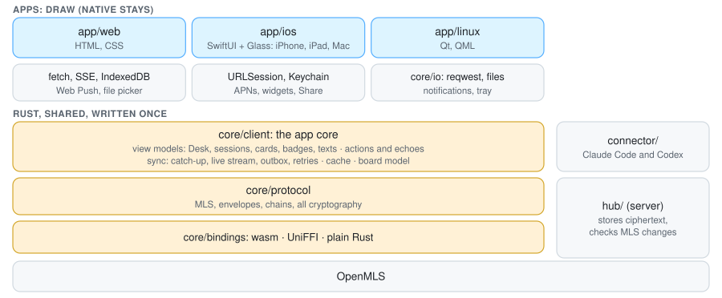
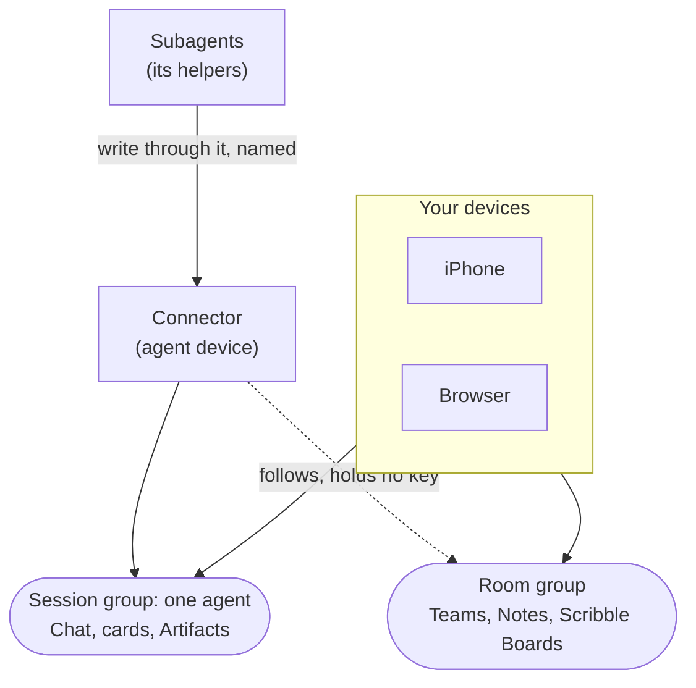
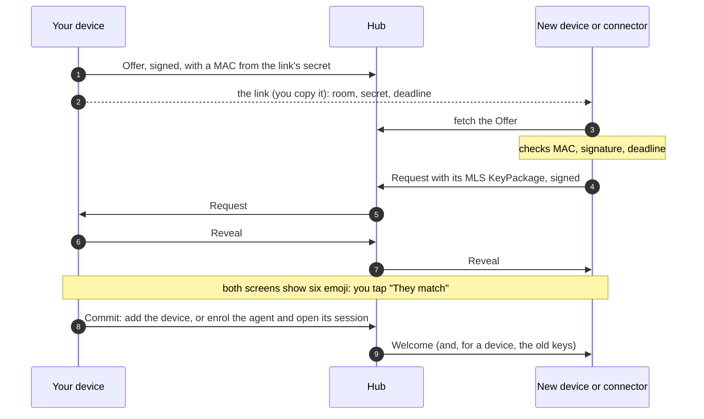
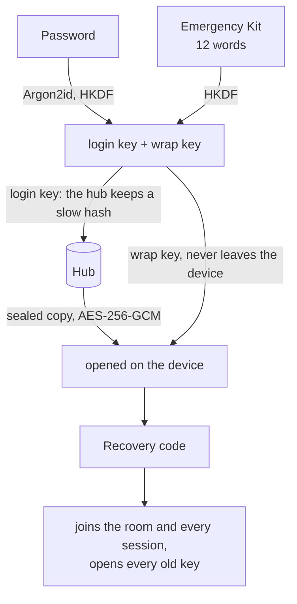
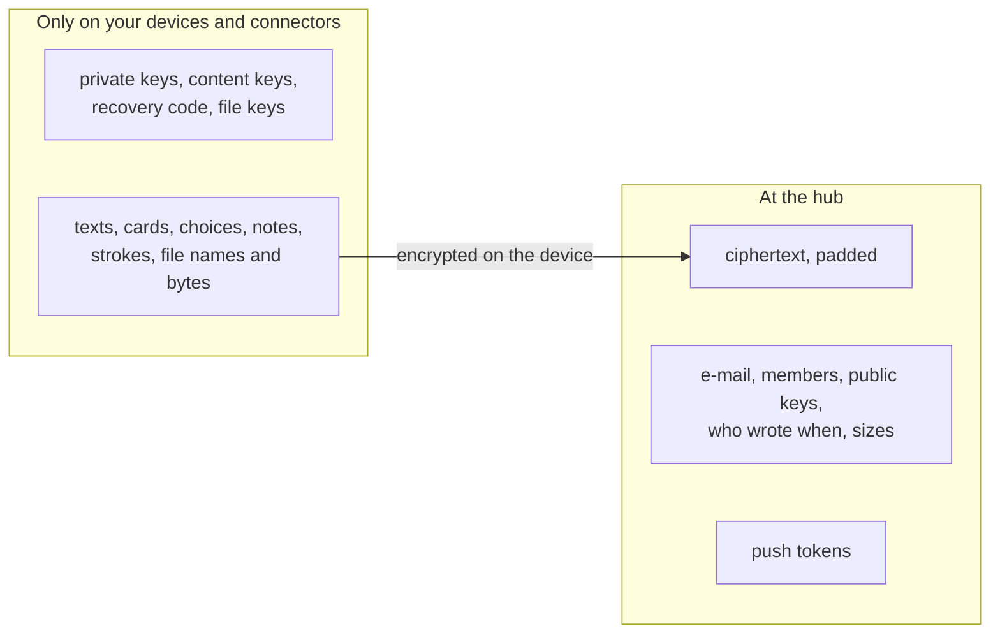
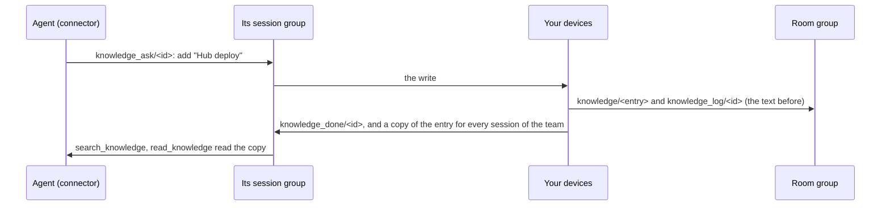
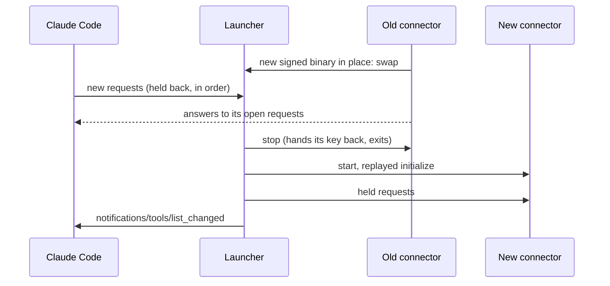

# Trommi

**Your agents ring. Answer anywhere.**


Your Claude Code and Codex sessions ask, you answer: chat, decision cards and a Scribble Board, on the web and on
the iPhone. Everything is encrypted on the devices with MLS (RFC 9420); the server only passes sealed messages on.
One Rust app core runs the web, iPhone, Mac, Linux and connector; the platform shells draw and perform I/O.

- 💬 **Chat** with every agent session, the terminal mirrored
- 🃏 **Decision cards**: the agent asks, you tap an answer
- ✏️ **Scribble Board**: draw, write, stick notes, send them to an agent
- 🗂 **Teams** to sort your agents, one dropdown switches between them; an agent's helpers show inside its session
- 🔒 **End-to-end encrypted**: the server never holds a key or reads content


<sub>Desk · Card · Chat · Scribble Board, from the made-up demo room (`demo/`).</sub>

**[→ Open Trommi](https://app.trommi.com)** · **[▶ See how it works](https://trommi.com/#demo)** (a four-minute video)

Settings → Devices shows when an offline device last contacted the hub. Signing out erases that device's
private state and durably queues only its signed public retirement notice. An online human app verifies the
notice and removes the exact device through the encrypted room's normal membership change. Offline logout
retries after a restart; contact times and missing profiles never authorize removal.

## Install

1. **The app:** [app.trommi.com](https://app.trommi.com) in any browser. On an iPhone: the public beta on
   TestFlight, [trommi.com/beta](https://trommi.com/beta) (the App Store gets reviewed versions less often).
2. **An agent**, on a Linux or macOS computer with Claude Code, Codex or Hermes Agent (for Hermes the app gives one
   line that does all of this, see Hermes below). The Trommi connector, once per machine:

   ```sh
   curl -fsSL https://raw.githubusercontent.com/chriopter/trommi/main/install.sh | sh
   ```

3. In the app: **Approve a computer**. In the project folder start `claude` (or `codex`) and paste the line it shows:

   ```
   Approve this computer in Trommi with this invite link: '<link>'. Call the Trommi connect tool with this link and computer=true.
   ```

   In Claude Code the plugin's slash command does the same: `/trommi:connect --computer '<link>'`. Claude Code asks once
   whether to use the trommi MCP server: choose "Use this MCP server". Six emoji appear in the terminal and in the
   app; tap "They match". Later sessions stay off the board until you run `/trommi:connect` without a link
   (or ask Codex to connect). An online Trommi app answers; no other agent session needs to be running.

Updates come by themselves: a running connector installs a new signed release and swaps compatible builds in.
The computer-approval release changes the MCP tool contract and needs one client restart; the update card says so
(`codex resume` keeps the conversation). By hand: `trommi-connector update`.

## How it works

- **Room:** everything of one account, shared by all of your devices.
- **Sessions:** each agent session is its own encrypted group: your devices and that agent, nobody else.
- **Hub:** the server stores ciphertext and who is in which group, and pushes to your devices. It cannot read a
  message, a card, a file or a key.
- **Dictation:** the chat field's microphone records, your device checks a Tinfoil enclave's attestation and seals
  the recording to it; the hub relays ciphertext only ([spec/v1.md](spec/v1.md) section 18, [SECURITY.md](SECURITY.md)).
- **Connector:** one signed program that joins a Claude Code, Codex or Hermes Agent session to your room.
  What the agent is told: [connector/prompt.md](connector/prompt.md).

<picture>
  <source media="(prefers-color-scheme: dark)" srcset=".github/readme/architecture-dark.svg">
  
</picture>

App logic exists once, in Rust under `core/`:

- `core/client/` (`trommi-client-core`): account flows, hub synchronization, history, actions and echoes, the board
  model, cache, notifications, share imports, and every screen's ordered ViewModel. The human apps run `App`;
  the connector runs its shared `Engine` in agent mode and reads the shared model.
- `core/protocol/` (`trommi-core`): MLS, envelopes, chains, the command gate, encrypted files, keys and protocol rules.
- `core/bindings/{wasm,swift}/`: one facade for the browser and Swift. `AppCore` exchanges events and effects;
  generated view types and folds keep both platforms on the same contract. Rust hosts use the crates directly.
- `core/io/` (`trommi-io`): the Rust executor for HTTP, raw event streams, stores, timers and the device-write barrier,
  used by Linux and the connector. It makes no app decisions.
- `core/wire/` (`trommi-wire`): formats, refusal codes, route limits, envelope framing and pure membership checks shared with the hub; no keys or I/O.

The apps draw the core's view state, pass taps and focus back, and perform platform services: fetch or URLSession,
IndexedDB or an encrypted journal, push, notifications, Keychain, file pickers, Live Activities and the share sheet.
They keep no second board model or sync implementation, and do not sort lists or decide state-dependent words.
The connector's driver adapts the same engine to MCP and its journal; its computer-key locking and platform I/O remain
in the connector. The hub checks public group changes with OpenMLS and `core/wire`; it holds no content keys.
The contract and platform boundaries are described in [The app core](core/client/README.md).

## Under the hood

<details>
<summary><b>Encryption</b> · MLS, one suite, one Rust core</summary>

- **MLS** ([RFC 9420](https://www.rfc-editor.org/rfc/rfc9420)) hands out every key, with
  [OpenMLS](https://github.com/openmls/openmls) `=0.9.1`.
- **One suite**, no negotiation: `MLS_128_DHKEMX25519_CHACHA20POLY1305_SHA256_Ed25519` (X25519, ChaCha20-Poly1305,
  SHA-256, Ed25519).
- **One Rust core** (`core/protocol/`, the crate `trommi-core`) does all of it: as WebAssembly in the browser, through UniFFI
  on iOS, natively in the connector. The hub checks group changes with OpenMLS itself and holds no keys. There is no second implementation.
- **A device is its key:** one Ed25519 key per device, made on the device; private keys never leave it.
- **Content** (chat, cards, notes, board items) is stored as signed envelopes, encrypted under a content key that
  MLS exports per group and key period. **Files** get a random key of their own each, sent inside the encrypted
  message that names the file.
- **History is readable by your devices, by decision:** a new device of yours gets the old keys and reads
  everything, and so does the recovery code. That is not forward secret for history. A copied device state opens
  nothing new after that device's next update (your devices update about once a week) or its removal.

</details>

<details>
<summary><b>Rooms, sessions and devices</b> · who is in which group</summary>



- **Room group:** all of your devices (at most 1000) and nothing else. It protects what belongs to you, not to one
  agent: Teams, Goals, team knowledge, Notes, Scribble Boards.
- **Session group:** one per agent session: your devices and that agent's connector. One agent never reads
  another's session, and no agent reads the room group.
- **Helpers:** an agent's subagents have no group or key of their own. They write through their agent's connector
  into its session group, each card, status line and message with the helper's name; the apps show them inside that
  session. (Until 16 October 2026 a helper got a session group of its own; those still open are read until their
  agent archives them, and the hub founds no new one.)
- Which team an agent sits on is only a value inside the room group: moving it changes no key.
- **Goals and team knowledge** live in the room group; your devices copy a team's into each of its sessions, so
  its agents read them there (spec/v1.md 9.3.4, 9.3.7).
- **Removing** a device or agent takes it out of every group at once, and the hub ends its access.

</details>

<details>
<summary><b>Joining a device or an agent</b> · a link and six emoji</summary>



- The **secret** is only in the link; the hub never sees it. The MAC ties the Offer to the link, so a hub cannot
  serve an Offer of its own.
- The **deadline** is in the link and in every key the secret gives: 10 minutes for a device, 15 for an agent.
  A link is used once; "They don't match" burns it.
- The **six emoji** (36 bits) are computed from everything exchanged, the new device's KeyPackage included. Nothing
  is added before you confirm them; this is what stops a hostile hub from slipping in a device of its own.
- **Signing in** on a new device with your password needs no emoji: the recovery code is the authority
  (Account and recovery, below).

</details>

<details>
<summary><b>Account and recovery</b> · password, recovery code, Emergency Kit</summary>



- Every room has one **recovery code** (32 random bytes). The account holds it only sealed: one copy under your
  password (Argon2id, 64 MiB, then HKDF and AES-256-GCM), one under the Emergency Kit's 12 words.
- The hub never sees the password, the words or the code. It keeps a slow hash of the login key and refuses to
  remove the last way in.
- With the code a new device joins the room and every live session, and opens the content key of every group and
  key period, which each change seals to the recovery key at the hub (HPKE). A MAC that only your devices can make
  ties those copies to you, so a hub cannot hand you a history of its own making.
- **Emergency Kit:** the 12 words and your account ID, to print. **Nobody can reset an account**: without password,
  kit and devices the content is gone.
- Wrong passwords slow the source down; there is no lockout. **Passkeys** are built and off for now.
- After you remove a device that is not in your hands, the app asks you to replace the code.

</details>

<details>
<summary><b>What the hub sees</b> · and what it cannot</summary>



| The hub reads | The hub cannot read |
|---|---|
| your e-mail, a slow hash of your login key | password, Emergency Kit words, recovery code |
| who is in which group, their public keys, every group change | any private key or content key |
| per stored item: sender, group, time, kind, a card's state and whether it knocks, the padded size | every body: texts, titles, options, choices, a card's urgency, when it was answered, strokes |
| files: id, padded size, uploader | file bytes, names, types, keys |
| per Scribble Board: when a snapshot was written, up to which item it reaches, which files are still on it | the shapes, what was erased |
| push endpoints and tokens | nothing: every push looks the same ("Something new."), its room and urgency are sealed for the device |

- The hub checks every MLS change it can check in public and refuses a device that was not invited.
- The hub keeps only what is still needed: a writer's older register values and Note versions, board items behind every device's snapshot, and objects settled 30 days ago lose their bodies; strokes being drawn are passed on and never stored.
- A room holds 4 GiB of files. When an upload would pass that, the hub deletes the oldest pictures of answered or closed cards and of session chats until it fits (never those of an open card, a board, a note or an Artifact); the apps show "Removed (storage full)" in their place.
- The whole table per stored thing: [`spec/v1.md`](spec/v1.md), section 14.

</details>

<details>
<summary><b>Releases</b> · built and released by hand</summary>

No machine builds or releases anything. The maintainer builds, checks and releases each part by hand on their own machines, when needed:

- **Before a release:** the tests of the part and of the core pass locally (see Build and tests).
- **The connector** gets a signed release series, `connector-v<N>`: one `manifest.json` (each file's size and
  SHA-256, `release/manifest.sh`), signed with Ed25519 (`release/sign.sh`). Public key:
  [`release/public-key.pem`](release/public-key.pem), compiled into the connector and held by `install.sh`; the
  private key stays with the maintainer. Connectors and `install.sh` take only a release signed with it.
- **The hub, the web app (app.trommi.com) and the website (trommi.com)** run as containers on the maintainer's own
  server, reached only through a Cloudflare tunnel. A release: build locally, copy it to the server, restart. How
  that server is set up is kept on the server, not in this repository.
- **The iPhone app** goes to TestFlight from a Linux machine, no Mac in the loop
  ([`app/ios/TrommiApp/AppStore/ship-local.sh`](app/ios/TrommiApp/AppStore/ship-local.sh): xtool, the darwin SDK,
  rcodesign), signed with the team's Apple Distribution identity. The Mac download outside the store
  (`Trommi-macOS.dmg`, releases `mac-v<N>`) is made on a Mac when needed: signed with the team's Developer ID,
  notarized and stapled, which macOS checks before its first start.
- **What's new** on the web and the iPhone is a static `/whats-new.json`, written when the web app is released, from
  the one summary a day (and at most one picture) in `app/web/public/changelog/CHANGELOG.md` and the days before in
  `history.json` there (frozen); `app/web/whats-new.mjs` reads both.

Check a connector release:

```sh
release/sign.sh verify manifest.json   # the signature
release/sign.sh files manifest.json    # each file against the manifest
```

**A release round, step by step.** On the release machine (Linux, x86_64): Rust from `rust-toolchain.toml` with its
targets, zig 0.14.1 and `cargo-zigbuild` (macOS connectors, the static hub), `wasm-bindgen-cli` of the version
`core/bindings/wasm/Cargo.toml` pins, Node of `.node-version`; for the iPhone app the toolchain of
[omarchy-apple-dev](https://github.com/joshuaswarren/omarchy-apple-dev) (`install-toolchain.sh --user-only`, the
darwin SDK of the Xcode whose Swift matches) and `~/.config/trommi/ios.env` (`ship-local.sh`'s head). Heavy builds one
at a time; tests per part. Every step builds the commit that is released (`git archive <commit>` into an empty
folder where a step builds outside the checkout).

1. **Connector** `connector-v<N>`, N above the last one:
   - `cargo test --locked -p trommi-core`, then `cargo test --locked -p trommi-tests --test connector_e2e --test connector_sessions`;
   - `TROMMI_RELEASE_VERSION=<N> node connector/build-plugin.mjs <dir>` (all four targets, the macOS ones by zig);
   - `release/manifest.sh trommi-connector <N> <commit> <dir>/trommi-connector-* > <dir>/manifest.json`, then
     `SIGN_RELEASE_KEY=… release/sign.sh sign <dir>/manifest.json` (it verifies what it signed), `release/sign.sh files`;
   - `install.sh --from <dir>` in an empty `HOME` must say "signature verified" before anything is published;
   - `gh release create connector-v<N> --target <commit> <dir>/manifest.json <dir>/manifest.json.sig <dir>/trommi-connector-*`;
   - check: `curl -fsSL …/install.sh | sh` in an empty `HOME`, `trommi-connector --version` ("release <N>, signature
     verified"), `trommi-connector update --check`, `trommi-connector setup claude` installs the plugin.
2. **Hub:** `cargo test --locked -p trommi-tests --test 'hub_*'`; build
   `TROMMI_COMMIT=<commit> cargo zigbuild --release --locked -p trommi-hub --target x86_64-unknown-linux-musl`; on the
   server first `trommi-hub dry-run` of the new binary on a copy of the live data (it must say `"ok":true`), then
   swap it in keeping the old one; `https://hub.trommi.com/healthz` names the commit.
3. **Web app:** `core/bindings/wasm/build.sh`, in `app/web` `npm ci && npm test`, then
   `GITHUB_SHA=<commit> node dev/build.mjs --write`; copy `public/` to the server and restart; `/gen/build.txt` names
   the commit, and `node app/web/dev/verify.mjs` **from a fresh tree of that commit** (not the one `--write` changed)
   says every built file is served as built.
4. **Website:** `node tests/site/check.mjs`, copy `site/public/` to the server and restart; check `/`, `/beta` (the
   TestFlight link), `www` and a missing page (404 with the site's headers).
5. **iPhone:** `ship-local.sh --dry-run` (every offline check passes, App Intents metadata of the `TrommiClient`
   package in the app, `TrommiLive` and `TrommiNotify`), then `ship-local.sh`; it uploads, waits for `VALID` and puts
   the build into the group Intern. Check on a phone: it installs, signs in, and a new card arrives as a push.

**Run your own hub:** `cargo build --release -p trommi-hub`, then `HUB_DATA=<folder> HUB_HOST=127.0.0.1
HUB_PORT=8790 target/release/trommi-hub`, behind a TLS proxy (`HUB_HSTS=on` once it serves only HTTPS). The web
app is static files: `node app/web/dev/build.mjs`, then serve `app/web/public/` (`app/web/README.md`).

</details>

<details>
<summary><b>Linux app</b> · Qt/QML drawing the app core (early)</summary>

[`app/linux`](app/linux) is a native Linux client: a Qt Quick window (`qml/`) that draws the app core's view model
and does the desktop's services. It is a Cargo workspace of its own, so the main workspace's builds and tests need
no Qt.

```text
qml/              the window: View*.qml draw ViewModel (sign-in, sidebar, Desk, a session, a card); a tap is an
                  Event::Action, a page an Event::Focus
src/shell.rs      the shell over the app core: the fold of every Render, the person's events, the slot's folders
src/platform.rs   what the core asks of the desktop: files for drawing, saving, links, notifications
src/notify.rs     desktop notifications over the session D-Bus
src/bridge.rs     cxx-qt: one QObject; the view as JSON text, the person's events in
core/io           the executor (trommi-io): HTTP, the event stream, the device/cache journal, the timer
```

**Binding.** The App (`core/client`) runs in trommi-io's loop on tokio; each `Effect::Render` is folded with the
core's own rule and handed to the window as JSON. Only the window crosses into C++, through
[cxx-qt](https://github.com/KDAB/cxx-qt): one object, plain properties. Nothing is decided in the app: what every
screen shows, its order and its words come from the core.

**Not yet.** The Scribble Board, notes, settings, pairing by invite link, packaging (Flatpak/AppImage).

**Run it** (Qt 6 with Qt Quick Controls, e.g. `qt6-declarative`; the Rust toolchain of `rust-toolchain.toml`):

```sh
cd app/linux && cargo run --release
```

`TROMMI_HUB` sets the hub (default `https://hub.trommi.com`), `TROMMI_LINUX_DIR` the data folder
(`<dir>/default/device` holds device and cache namespaces in one journal; `<dir>/default/cache` is imported once from older builds). `cargo test` runs the conformance
scripts through the app's fold, and the app against the real hub (`tests/hub.rs`, which builds `trommi-hub`).
`TROMMI_LINUX_SHOT=<file.png>` (with `QT_QPA_PLATFORM=offscreen`) draws the window once, writes the picture and
quits: the smoke test. Pictures over the real hub: `TROMMI_LINUX_SHOTS=<dir> cargo test --test hub
-- --ignored pictures` (`TROMMI_LINUX_SCENE=card|session`).

</details>

<details>
<summary><b>Team knowledge</b> · what every agent of a team knows, kept up to date by the agents</summary>

Each team has its knowledge: short entries (a title, at most 600 characters of text, a kind: rule, decision, fact or
where, pinned or not, when it was last confirmed) that every agent of the team reads and keeps up to date on its own,
such as where the deploy runs or how releases go. The Knowledge page of a team (its tile on the Desk; on the iPhone
also the pill's menu) lists them, pinned first then the newest, with a search and the filters New, Pinned and
Forgotten; it marks what agents changed since you last looked, opens an entry with its history and an Undo for each
change, and brings a forgotten entry back for 30 days. You add, edit, pin and forget entries there too; only you pin.



- **Stored** as encrypted registers in the room group, which no agent reads: the entry `knowledge/<id>`, its history
  `knowledge_log/<id>` (the newest ten changes, each with the text before), when you last looked `knowledge_seen/<team>`
  (spec/v1.md 9.3.7). Your devices copy a team's entries into each of its main sessions, as they do with the goals.
- **Agents read** with `search_knowledge` (a full-text index over the session's copy, in the connector) and
  `read_knowledge`; at its start, and whenever the entries change, an agent gets a short digest with a tool's result:
  the pinned entries and the newest titles. Its chat shows a quiet line "reads team knowledge (12)".
- **Agents write** with `add_knowledge`, `update_knowledge` (with nothing new it confirms an entry) and
  `forget_knowledge`, without asking: the write goes into the agent's own session, and your devices apply it on their
  own (a change only while the entry is as the agent read it, never a pin) and answer it there; a refusal (a title
  that exists, an entry changed since) is told to the agent. The tools say when to write: lasting rules, decisions,
  preferences and corrections, not status or to-dos; update instead of adding a second entry.
- The hub sees encrypted registers, as for everything else. The logic is the app core's (`core/client/src/knowledge.rs`).
- **A chat on no team.** A chat stands on a team only while its settings name that team and the team is there; else
  it is on no team, at the top of the list beside the team folders (on the iPhone above the folders, in the root list
  whose bottom row, as on a team's page, holds the search, the bolt over every team and the +). That is the case for `desk` null (Move to… → No
  team, or "No team" when you invite an agent or start a new chat), for a chat whose settings name no team (as chats
  from before this rule may, and a chat whose placement has not reached this device yet), and for a chat whose team
  was deleted. Every agent invite and approved computer now writes its chat's team, or null. A chat on no team gets no
  team's goals or knowledge: your devices take the copies it held out of its session, and refuse its agent's writes
  (`no_team`), until a team that is there is named for it. Its open cards are on the Desk of every team and the bolt,
  not on a team's count. What its agent read while it was on a team it may still know, as when a chat moves from one
  team to another. Chats of one Hermes still share their Trommi tools, as above: a Hermes chat on no team can use the
  tools of that Hermes's chats on a team. One rule decides a chat's team for every part of the app
  (`sessions::team_of`).

</details>

<details>
<summary><b>Wakeups</b> · an agent starts again later on its own, on its computer</summary>

An agent sets itself a wakeup with `wake_me` ("in 30m", "at 09:00", "every 1d", and a note of what to do then). Its
connector keeps the clock on the computer the agent runs on: when one is due it hands the note to the agent, and when
the session was closed it starts the agent's program again on that conversation (Claude Code `-p --resume`, Codex
`exec resume`). Limits: 5 open per session, 2 that repeat, 12 runs a day, nothing from 22:00 to 07:00, a woken run
at most 30 minutes (in Claude Code also 30 turns), a pause while the subscription's five-hour window is 80% used. Claude Code's asks
for permission in a woken run come to you as yes/no cards. The Wakeups page of a team (the chat's title menu, the
sidebar's menu; on the iPhone the pill's menu) lists them, the next first, with how often, who set it and how its last
run went; you cancel one or give it another time there. The chat shows the next one as "Wakes at 09:00".

- **Stored** as encrypted registers in the agent's session: `wakeup/<id>` (written by its connector) and your word on
  it `wakeup_edit/<id>` (cancel or another time; the connector applies it and your devices then clear it).
- **Rules** in `core/client/src/wakeups.rs` (guardrails, the clock's tick), the page in
  `core/client/src/views/wakeups.rs` (web `app/web/public/wakeups.mjs`, iPhone `WakeupsScreen.swift`), the clock and the waker in `connector/src/server.rs` and
  `connector/src/wakeups.rs`; spec/v1.md 9.3.8.

</details>

<details>
<summary><b>Hermes</b> · Trommi as a Hermes platform, a chat per topic</summary>

[Hermes Agent](https://hermes-agent.nousresearch.com) gets Trommi as one of its platforms, like Telegram: the add-on in
`connector/hermes/` (its README has the details). In the app, Approve a computer and pick the tab Hermes: it gives
one line to paste on the computer where Hermes runs,
`curl -fsSL https://raw.githubusercontent.com/chriopter/trommi/main/install.sh | sh -s -- hermes --name Einkauf --link '<link>'`.
It installs the Trommi connector (or updates it), then `trommi-connector setup hermes` writes the add-on into the
Hermes home, turns it on, configures the platform `trommi`, approves the computer with the link (you compare the emoji
in the app, as for any agent) and restarts Hermes' gateway. The first chat is then on
the board. A second Hermes is a Hermes profile with a name of its own (`--name Einkauf --profile einkauf`).

- **Every Trommi chat is a Hermes chat.** Your message goes to Hermes, and its answer comes back into the same chat,
  growing while it writes (an answer preview, spec 7.5). Its working face follows the automatic turn, including
  thinking and tool work, and stops on finish, error or cancellation. Manual task status lines remain saved and can
  still count as session work; they do not keep Hermes' typing face or the Live Activity's work mark on after the
  turn ends. An expired working lease clears even with an open stream, including on reconnect. Its questions for
  approval come as yes/no cards, and no answer is no.
- **"New chat with …"** under the + (iPhone: the + menu) starts another chat with that Hermes. Its connector activates
  itself on the approved computer, without a tap there. It stands where you chose: a team, or no team. Your device
  writes that choice into the ask itself. The new chat's connector names only the ask it answers, and the app that
  lets it in places it from your ask, each ask once and within the 15 minutes of an agent invite. Until its place
  reaches a device, that device counts it on no team. An ask that cannot be read there (too old, used, from someone
  else, or of a team that is gone) puts the chat on no team, never on a team you did not choose. With no choice made,
  it stands where the approved computer stands (its team while that team is there, else no team).
- **Exact routing.** The board tools are Hermes tools (`trommi_<name>`). A call from a Trommi chat acts in that chat.
  A call from another conversation of that Hermes (for example on Telegram or from cron) acts in its main chat.
- **One connector per chat.** The add-on starts the connector once per chat and speaks MCP to it. Each holds the key of
  its chat. The add-on is part of the signed connector release, and a newer connector writes it again when it starts.

</details>

<details>
<summary><b>Connector updates</b> · swapped in, no reconnect</summary>

What Claude Code or Codex starts is a small **launcher** ([`connector/src/launch.rs`](connector/src/launch.rs)). It
owns the session's stdin and stdout and runs the real connector as its child, passing every JSON-RPC line through.

- **Found:** the connector looks for a newer release every hour, and at once when the hub refuses it as too old.
- **Checked:** only a release signed with the release key is put in place, as `trommi-connector update` does.
- **Swapped:** the launcher holds the client's new messages back, lets the old child answer every request it took,
  stops it, starts the new one, replays the session's handshake to it, then sends the held messages and
  `notifications/tools/list_changed`. The client keeps the same process and pipe, so it never sees a restart.



- Sessions started before the launcher existed need **one** /mcp → trommi → Reconnect; after that, never again.
- The launcher almost never changes. If an update needs a new one, the app shows the update card with that one
  reconnect instead.

</details>

<details>
<summary><b>Account and usage per agent</b> · plan, e-mail, 5-hour window and week</summary>

Each agent's card in Settings → Agents shows the plan and e-mail its program is signed in with and how much of the
5-hour window and of the week is used; a session's heading shows the two bars. The connector
([`connector/src/usage.rs`](connector/src/usage.rs)) writes them as `account` into its main session's `profile`
register: end-to-end encrypted like the rest of the profile, never in the hub's metadata, never in a log. It looks
about once a minute and sends only what changed.

- **Claude Code:** `claude auth status --json` names the e-mail and the plan. The windows Claude Code hands only to
  a status line, so `setup claude` (and the installed connector once at its start) puts `trommi-connector
  statusline` in as the status line of Claude Code's user settings (`settings.json`, only that member). A status
  line that was there runs as before, with the same input, its output passed on unchanged. The windows land in
  `~/.local/share/trommi/usage/` (0600, no e-mail). `trommi-connector remove claude` puts the old status line back
  and removes the plugin.
- **Codex:** its app server (`codex app-server`: `account/read`, `account/rateLimits/read`) gives plan, e-mail, the
  week, credits and free full resets. Without Codex nothing is sent.
- No credential file of another program is read. `TROMMI_USAGE=off` turns it off.

</details>

<details>
<summary><b>Protocol</b> · spec, deviations, hub API</summary>

| | |
|---|---|
| [`spec/v1.md`](spec/v1.md) | the protocol: groups, content, recovery, joining, what a hub must do and sees |
| [`spec/v1-deviations.md`](spec/v1-deviations.md) | the five places where plain MLS is not enough, and why |
| [`spec/hub-api.md`](spec/hub-api.md) | the hub's routes and tables |
| `spec/vectors/` | known answers the core must produce |

The code follows the specification, not the other way round. More: [`spec/README.md`](spec/README.md).

</details>

<details>
<summary><b>Known limits</b> · what this does not protect</summary>

- No forward secrecy for history (see Encryption).
- The hub sees who is in which group and when anyone writes.
- In the browser, the app's code is loaded from app.trommi.com each time; whoever controls that delivery (our
  server, our Cloudflare account) could ship code that reads your keys. The hub cannot.
  The iOS app and the connector do not have this risk: they are installed signed releases.
- The connector checks its updates, not its own start.
- A hub rollback does not roll back the database.
- Post-quantum: planned once OpenMLS ships a suite.

The whole list, with everything that is in place: [SECURITY.md](SECURITY.md).

</details>

## Development

Work happens on branches; finished work is merged into `main` by hand, with the tests green locally. One GitHub check
(`.github/workflows/check.yml`: cargo check, rustfmt, the web app's typecheck and light tests) gives pushes to `main` and
pull requests their tick; it reads no secret and ships nothing. Builds and releases are made by hand (see Releases above).

The hub shares one read scope for full and brief Desks and settled objects. Group membership and archive
filters are unchanged; membership tests use a sorted lookup set, and unfiltered reads do not load the archive
list. Five samples on a private synthetic 4,038-group SQLite fixture gave brief-Desk medians of
39.92 → 2.76 ms unfiltered and 39.76 → 21.18 ms for active sessions, with byte-identical replies. These are
same-profile debug-build route-function measurements, not production HTTP latency or throughput.

<details>
<summary><b>Repository layout</b> · core, hub, apps, connector</summary>

| | |
|---|---|
| `core/protocol/` | the protocol core in Rust on OpenMLS: MLS, envelopes, chains, files |
| `core/bindings/` | the one facade over both cores: `wasm/` for the browser, `swift/` for iOS and the Mac |
| `core/client/` | the app core: accounts, sync, history, model, cache, actions, notifications and ViewModel, shared by every app and connector |
| `core/io/` | native Rust executor: HTTP, streams, stores, timer and write barrier |
| `core/wire/` | what the hub and the app core read the same way: refusal codes, the limits of the hub's routes, the formats of spec/v1.md |
| `hub/` | the hub (the server) |
| `app/web/` | the web app |
| `app/ios/` | iPhone and Mac SwiftUI shells and isolated iOS extensions |
| `app/linux/` | Qt/QML shell over the core and native executor |
| `connector/` | the connector: the program and the Claude Code plugin |
| `demo/` | the demo room, built into the web app and the iOS app |
| `tests/` | every part's tests, one folder per part; `tests/tools/`: `seed_account.rs`, which fills an account from the demo room (the App Store review account) |
| `spec/` | the protocol, the hub's API, the test vectors |
| `release/` | the connector's signed release: manifest, signature, public key |
| `site/` | the website trommi.com |
| `dev/` | tools for by hand: fuzz campaigns, the tables of THIRD-PARTY.md |

Each part has its own README with the details.

</details>

<details>
<summary><b>Build and tests</b> · Rust, Node, Swift</summary>

Rust is pinned in `rust-toolchain.toml`, Node in `.node-version`.

```sh
# Core, hub, connector
cargo test --locked -p trommi-core
cargo test --locked -p trommi-client-core   # the whole app core
cargo test --locked -p trommi-tests          # core, hub and connector tests
cargo build --release -p trommi-hub -p trommi-connector

# Web app (its package.json is in app/web)
(cd app/web && npm ci)
(cd app/web && npm run build:core)            # the core as WebAssembly
(cd app/web && npm test)
node app/web/dev/serve.mjs 8900               # the app; ?mock=1 for the demo room

# iPhone and Mac
core/bindings/swift/build.sh                           # the core for Swift
(cd tests/ios && swift test)
```

The three scale tests (a room of 1000 human devices, a catch-up across twenty groups, 100 helpers in one session) run
small by default and at full size with `TROMMI_TESTS_FULL=1`.

The session matrix (`tests/connector/sessions.rs`, test `connector_sessions`): many Claude Code and Codex sessions on
one machine, two Trommi accounts, one folder and several, resume, /mcp restart, a killed connector, a stale key, a
explicit computer activation beside a link join. Each case ends with every session on its account's board with a key of its own. A default
run takes its fast cases, `TROMMI_TESTS_FULL=1` all; `TROMMI_MATRIX_LOGS=<folder>` keeps each
connector's log.

All clients against each other: the web app (the app core in its
executor), the native Swift AppCore executor and the connector, each twice, in one room on a real hub, through one
long seeded random timeline; it fails where two devices show anything different. Then their speed with 1,000 cards.

```sh
tests/client/mega/prepare.sh .                # the core for the browser and for Swift, the iOS test runner
MEGA_SEEDS=1,2,3 cargo test -p trommi-tests --test client_mega every_client_shows_the_same -- --ignored --nocapture
cargo test -p trommi-tests --test client_mega speed_of_every_client -- --ignored --nocapture
```

More: [`app/web/README.md`](app/web/README.md), [`app/ios/README.md`](app/ios/README.md),
[`connector/README.md`](connector/README.md), [`core/protocol/README.md`](core/protocol/README.md), [`core/client/README.md`](core/client/README.md).

</details>

<details>
<summary><b>Fuzzing</b> · libFuzzer targets, property tests</summary>

The harnesses are in `tests/src/fuzz/`, one `run(bytes)` each; the libFuzzer targets in `tests/fuzz/` (a cargo-fuzz
crate of its own) are one line each. Every run checks properties, not only "no panic":

| Target | What | Properties |
|---|---|---|
| `core_decode` | every decoder of the core | `decode(encode(x)) == x`; canonical where the format says so |
| `board_merge` | Scribble Board items of up to four writers | any order and replays give one board; a snapshot reads back |
| `content_flow` | stored content through the hub's and devices' checks, with forgeries | flipped bytes, foreign signatures, non-members and replays are never taken; hub and devices agree |
| `mls_devices` | real OpenMLS devices against the hub in memory | replayed and flipped log entries change nothing; devices converge; an outsider opens nothing |
| `hub_api` | every non-streaming route (`api::fuzz_route`, feature `fuzz`) | no `internal` on bad input; nothing of one room served outside it |
| App view/cache (`core/client/tests/cache.rs`, `views.rs`) | checked model records and ordered deltas | cache restoration and folds reproduce the core's view |
| `connector_text` | board text in channel tags, received file names, invite links | no tag can be closed or opened; no hidden characters; files stay in the cache |

```sh
# every kept reproducer and seed, then random inputs (FUZZ_CASES, default 64)
cargo test --locked -p trommi-tests --test core_fuzz_props
FUZZ_TARGET=devices FUZZ_FILE=crash-… FUZZ_DEBUG=1 cargo test -p trommi-tests --test core_fuzz_props one_input -- --ignored --nocapture

# libFuzzer (cargo install cargo-fuzz; RUSTC_BOOTSTRAP=1 lets the pinned stable compiler build it)
cd tests/fuzz && RUSTC_BOOTSTRAP=1 cargo fuzz build -O -s none
dev/fuzz/campaign.sh 3600 4 core_decode hub_api   # seconds, workers per target, targets; corpus and crashes in tests/fuzz/

# black box: the hub over real HTTP (raw requests), the built connector over MCP (tool calls and lines)
FUZZ_HTTP_CASES=5000 cargo test -p trommi-tests --test hub_fuzz_http -- --nocapture
FUZZ_MCP_CASES=5000 cargo test -p trommi-tests --test connector_fuzz_mcp -- --nocapture
```

A crash is minimized (`cargo fuzz tmin`), kept under `tests/fuzz/regress/<target>/` (replayed by `fuzz_props`), and
fixed. Seeds: `tests/fuzz/seeds/` (`cargo test -p trommi-tests --test core_fuzz_props write_seeds -- --ignored`); the
growing corpus stays out of git.

</details>

## License

Open code, self-hostable, under the [O'Saasy license](LICENSE.md): read it, change it, run your own hub; only selling it as a competing hosted service is not allowed. Third-party licences: [THIRD-PARTY.md](THIRD-PARTY.md) (the web app's own:
[`app/web/THIRD-PARTY.md`](app/web/THIRD-PARTY.md)).

Found a vulnerability? Write to trommi@mail101.de.
