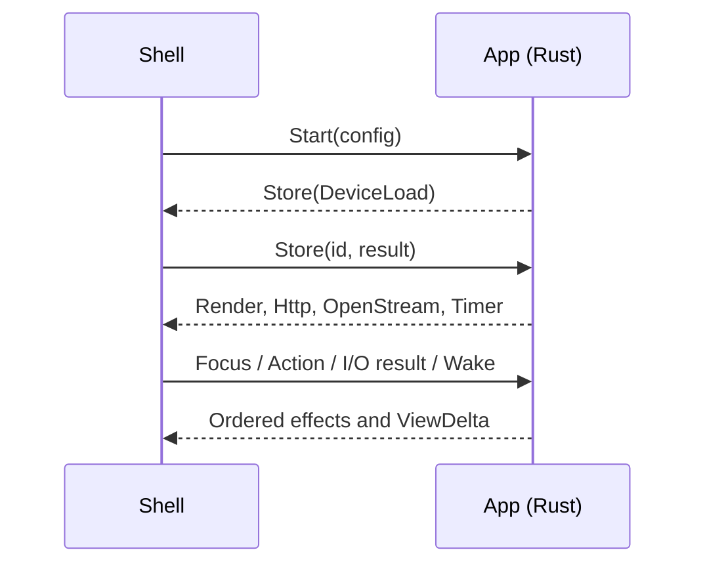

# trommi-client-core

The app core: every Trommi app decision, written once in Rust. Web, iPhone, Mac and Linux run `App`; the connector
uses the same engine in agent mode. Platform shells draw or integrate with MCP and execute I/O. The protocol core
underneath owns MLS, envelopes, chains, command gating and encrypted files. No platform keeps a second sync
engine, board model or account implementation.

## The app core

`App::handle(now_ms, Event) -> Vec<Effect>` is the human apps' contract. One App owns one slot and receives events
serially. It has no network/storage handles or UI callbacks. The host supplies time and services; the protocol's
cryptographic randomness comes from the system and is independent of the retry-jitter seed.



`Start` names the platform, version, slot, locale, zone, jitter seed, optional hub and capabilities. An empty hub
uses the stored room's hub, otherwise the default. `Config.demo` instead supplies the shared fixture and runs the
same app entirely in memory. The human apps draw only `ViewModel` deltas. The connector needs no human view and
uses `engine::Engine`, `engine::feed::Board`, the shared model and cache directly, with `become_agent` and the
agent-mode lease/command/removal rules.

## What lives here

| Module | Responsibility |
| --- | --- |
| `src/app/` | App lifecycle, account flows, push policy, native shares, invites, external snapshots, and effects |
| `src/actions/` | Named taps/edits, validation, optimistic echoes, sealing, undo and refusal rollback |
| `src/engine/` | Authentication, catch-up, Welcomes, live order, outbox, retry timing, history checks and agent mode |
| `src/hub/` | Hub routes, request construction, authentication/lease headers, strict responses, limits and refusal codes |
| `src/model/` | One board model, shared by human apps and connector, fed only from checked protocol results |
| `src/views/` | Ordered screen views, action modes, words, badges, status lines, file references and delta/fold types |
| `src/cache/` | Revision-bound model records and load/save plans over the shell's disposable key/value space |
| `src/app/past.rs` | History windows, verified historical versions, transient-failure retry and lazy reads |
| `src/files.rs`, `src/scribble/` | File lifecycle and encryption requests; board items, packed strokes and snapshots |
| `src/account/`, `src/machines.rs`, `src/selfjoin.rs`, `src/seats.rs`, `src/team_delete.rs` | Account authority, computer approval and hash-bound activation, session founding and resumable team deletion |
| `src/status.rs`, `src/sessions.rs`, `src/off_mind.rs` | Shared status, session and card-placement rules used by views |
| `src/faces.rs` | The 24 agent faces (names, words, topics), the symbols of before mapped to faces, and which face a session wears |

Code sign-in starts from the room state authenticated by the recovery code when it is current. It joins the
room before reading old room Commits, starts catch-up at that accepted join, and reads the Desk for current
content. Live sessions require earlier room states: the engine verifies that backward history in bounded pages
against its held origin before checking their history or recovering old room keys. New membership actions also
wait for that verification. Old room settings on the first Desk also trigger it. A first Desk with neither old
room values nor live sessions leaves old room Commits unread, including after restart. Recovery and old recovery
links retain the complete-history check. Opening older messages in a held session also requests its missing verified epochs, in room/main/helper order,
then reads back the envelopes and requests missing content keys through the existing handover flow. A failed
network read retries; an unverified history never becomes readable content. Recovery-code keys stay in memory only; an interrupted sign-in asks for
the code again on the same device when its old keys or unfinished session joins still need it.

## Events and effects

The Rust types in `src/app/{event,effect,io}.rs` are the contract. The WASM/UniFFI facade's `AppCore` takes an
`AppPacket`: JSON plus a list of byte buffers; JSON byte fields are indices into that list. Native Rust hosts use
the typed events directly. There is no serialization of private protocol state to the UI.

| Event | Meaning |
| --- | --- |
| `Start` | Configures and opens the slot, or the in-memory demo |
| `Focus` | Screen, team, visibility and optional board in view |
| `Action` | A tap/editor result; account steps are `Action::Account` |
| `Http`, `Stream`, `Store`, `Secret`, `Platform` | Result of the effect with the same I/O id |
| `Wake`, `Net`, `Foreground`, `Background`, `Zone` | Clock/network/lifecycle/zone changes |
| `Push`, `PushToken` | Raw platform push/token data; the core checks it and owns registration policy |
| `Progress`, `Finished` | Optional transfer progress or completion |

| Effect | Shell responsibility |
| --- | --- |
| `Render` | Fold `ViewDelta` into the generated ViewModel, then draw |
| `Http` | Send the exact request, enforce `max_answer`, and return status/headers/raw body |
| `OpenStream` | Forward ordered raw opened/chunk/ended/failed events; parsing is Rust's |
| `Cancel`, `Timer` | Cancel that I/O id; replace the single wake-up timer |
| `Store` | Execute the specified device/cache operation and return its result |
| `Secret`, `Platform` | Private platform secret storage, push registration or another declared capability |
| `FileReady`, `FileGone`, `SaveFile`, `OpenUrl` | Drawing bytes, their removal, export and external navigation |
| `Notify` | Display the core's already selected notification and words |
| `Snapshot` | Draw widget/Live Activity counts and ordered waiting cards; publish the core's ordered share teams |
| `NotifyContext` | Replace the notification extension's read-only context/key copy, or clear both |
| `ShareInbox` | Finish or release a native sealed-inbox claim after the preceding durable write |
| `ForgetShared` | Erase the native shared inbox/key after account deletion or verified signed removal |
| `Log` | Diagnostics without content, credentials, keys or tokens |

A request's route, authentication, retry policy and caps come from the core. The executor disables implicit
redirects and extra credentials and never retries on its own. It rejects a response above `max_answer` before
buffering more than the limit, including a declared Content-Length above it; it never passes a truncated success.
For an open stream, the cap bounds a non-200 body and the core bounds/parses each event. The default cap is 64 KiB.

I/O ids are unique within an App. A closed/replaced App drops late results. A refused platform capability is an
ordinary result, not an app decision in the shell.

## Durability and ownership

Every core call and its effects preserve their order. A `DeviceApply` is a barrier: no effect behind it, including
one from a later event, may run until the write is durable. The shell can deliver incoming events while waiting,
but queues their effects behind that barrier. A failed device write drops what waited behind it and reports the
failure to the core. No sealed message may leave before its corresponding device/outbox write succeeds.

The shell holds one exclusive owner lock for a device slot before reading it and retains it until close. The
revision check behind the lock refuses another writer. The device space is an atomic batch of binary entries
(`DeviceLoad`, `DeviceApply { expected_revision, put, delete }`); it contains private state, chains, groups and the
outbox. Rollback checks never silently make a new identity over unreadable state.

Chain heads, epoch counts and frontiers, register values and their name bindings, and the device's random
register IDs are stored as separate components. A write replaces only components that changed. Register names
stay inside values; storage keys use the existing random register IDs. Whole records from earlier builds remain
readable and are replaced in the same atomic batch as their first update, including staged joins. A failed
migration leaves the prior state intact; missing components and mixed whole/split forms are storage errors.

The cache space is separate: string keys and bytes, with get/scan/keys/put/delete. Keys start with
`c1/<room>/`; `src/cache/layout.rs` names the model/meta/window/draft records. Values describe checked model data;
file cache bytes retain their encrypted hub representation. Metadata binds a model to the device identity and
revision. Losing disposable model cache costs a catch-up; it never loses the protocol outbox. Physical storage, encryption at rest,
locking and filesystem-safe key encoding belong to the executor.

On the web, device batches append one packed, still-encrypted IndexedDB delta with their revision in one
strict transaction. The log compacts geometrically into bounded checkpoint pages; opening reconstructs the
current entries without keeping another live device mirror. Schema upgrades retain legacy entries and refuse
older writers. Empty-store cleanup checks both checkpoint and journal before removing a slot.
On Linux, device and cache use separate namespaces in the same `core/io` journal, as on the connector. Every
multi-key cache put/delete commits as one synced record. Old per-key cache files migrate once, with a durable
marker in the same commit, before removal; a failed write makes further cache reads fail until reopen.

The public logout outbox is the exception to disposable cache data. `public-departure/<room>.<device>` holds
only a strict, signature-checked hub/room/device/signature record, at most 2048 bytes, with no bearer or content
key. `StoreOp::PutDurable` syncs both values and their names before answering: a strict IndexedDB transaction,
a journal commit, or a native atomic write followed by file and directory sync. New notices are persisted before
private key erasure even when older deliveries occupy the transport. Pending notices are never dropped for an
arbitrary queue length; at most eight delivery operations run together. They share the core's hub backoff and
retry after restart without opening a device, and are deleted durably only after a checked hub acknowledgement.
A current or later human app verifies the exact signature and actual human membership, waits for anchored room
history, and makes the ordinary room Cut/removal Commit. Missing names and activity hints never authorize removal.

After the public-notice startup scan succeeds, sign-out lists cache names with `StoreOp::Keys` rather than
reading and copying private values through the binding. Rust journals enumerate their key index, IndexedDB
uses `getAllKeys`, and the native store lists encoded filenames without decrypting values. If that initial
public-notice scan failed, sign-out retains a full scan so an unread valid departure notice survives erasure.

Sign-out drops plaintext model/file/account buffers, ends the token and wipes the slot and private cache. A human device is
erased for removal only after the protocol checked its signed removal. A hub claim alone leaves state intact.
Extension key clearing precedes erasure writes so a full disk cannot leave a stale key copy; failed erasure remains
visible. `ForgetShared` is reserved for verified removal/account deletion, so launching an empty slot cannot erase
legitimate shares waiting to be imported. See [Security](../../SECURITY.md).

## Native integrations

The core supplies notification text and suppresses initial catch-up/foreground notices. `NotifyContext` carries the
push key, room/hub/client/cursor and only each session group's current content key; never the room key or device
key. Turning notifications off clears the content-key copy. Sign-out/removal clears the context as well. Native
storage failures must clear the previous copy. The notification extension's deliberately narrower verification
and authority are documented in Security.

`Snapshot` is sent only when it changes. It includes waiting/working counts, urgency, ordered cards (at most 20),
room, ordered share teams/crowns and `live_activity` policy. Unknown policy waits for the core's push-level read;
false ends the activity. `PushToken` kind `apns_live_activity` uses the core's room/device tag, registration bound
and duplicate suppression without replacing ordinary APNs registration.

`ImportShare` checks the original room before uploading, waits for every file, picks the current crown or an
allowed recipient, otherwise keeps a Note, and carries an import id for deduplication after restart. Its inbox
acknowledgment waits behind the device-write barrier. `WriteNoteFiles` and `DrawStroke` similarly keep attachment
references and protocol stroke encoding in Rust.

## What a shell may do

A shell draws, navigates and handles input. It owns gestures, layout, image clipping, the pen, native file pickers,
theme/fold preferences, platform push/notifications, Keychain, widgets, extensions and the requested I/O. It may
choose how a view fits available space. It may not keep a domain model, sort/filter the core's lists, count badges,
retry requests, implement account authority, or build words from domain state. State-dependent text is
`Text { key, args, en }`; generated fields already express the screen's modes and available actions.

| Platform | Core and executor |
| --- | --- |
| Web | `AppCore` in `app/web/core/core-worker.ts`; `shell.ts` uses fetch/IndexedDB, page folds/draws |
| iPhone/Mac | `AppCore` through UniFFI; `CoreSession` actor in `app/ios/TrommiClient/Sources/TrommiShell`, URLSession and encrypted journal/Keychain |
| Linux | Rust `App`, `trommi-io`, Qt/QML shell |
| Connector | Shared agent `Engine`/model/cache through `connector/src/driver.rs`, `trommi-io`, MCP and slot journal |

The retired app-logic paths are deleted. `tests/shells.rs` and `tests/shells.json` keep the shrinking-only boundary;
there is no legacy-mode switch or fallback implementation.

## Tests and bindings

```sh
cargo test --locked -j4 -p trommi-client-core
cargo test --locked -j4 -p trommi-io
node tests/bindings/manifest.mjs
node tests/bindings/views.mjs
node tests/bindings/views-replay.mjs
```

Run heavy builds serially under the repository's resource limits. `tests/conformance/*.json` describes input
scripts, expected effects and views. `tests/view_scenes.rs` records signed-room scenarios into
`tests/conformance/views/`, and web/Swift folds replay the same deltas. Out-of-order deltas are refused.
`tests/bindings/views.mjs --write` derives TypeScript and Swift view types from `src/views/mod.rs`; the manifest
check covers the shared facade. Binding outputs are rebuilt by `core/bindings/{wasm,swift}/build.sh`.

Rust suites cover actions, history consistency/recovery, durability, accounts, imports, notifications, agent
leases/command gates and signed-removal verification. Native shell suites cover executor/store/transport and
isolated extensions. `tests/client/mega.rs` compares the shipped shells against the local real hub; its small
seeded correctness runs and the separate opt-in nightly fleet/load tests are described in the root README.

Settings → Data uses `AccountAction::ReadUsage` and `SettingsView.data`. The core authenticates the request, validates counts and sizes, presents the rows and clears them when the account is forgotten.

After a Commit carrying Cuts, the app core asks the protocol device which values now stand for the registers it
was showing. This covers both listed values and values already read through a sender's chain: the model does
not keep a value the protocol replay discarded. A device-name register records its source group in the cached
room record, so a session Cut cannot clear a name learned from the room. Cache layout revision 2 rebuilds older
model snapshots that lack this provenance; the device's durable protocol state is untouched.

The Devices view formats the hub's last-contact hints in the person's timezone. Presence can hold a bounded report until a signed group names its device; activity never creates membership or authorizes removal.
