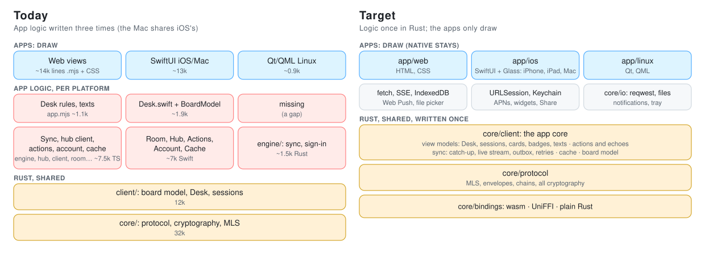

# trommi-client-core

The client core, growing into the app core: everything a Trommi app decides, written once in Rust. It sits above
the protocol core ([`core/protocol/`](../protocol/README.md): MLS, envelopes, chains, the command gate) and below
the apps. It does no I/O: the app fetches, stores and draws; the core decides.

<picture>
  <source media="(prefers-color-scheme: dark)" srcset="../../.github/readme/app-core-dark.svg">
  
</picture>

Today the apps still hold part of the logic (left); the app core (`src/app` and its modules, below) takes it over,
one platform at a time (right).

## What lives here

| File | What | Used by |
| --- | --- | --- |
| `src/app/` | **The app core** (`App`): one object per room, `handle(now, Event) -> Vec<Effect>`. The contract's types (`event.rs`, `effect.rs`, `io.rs`), bytes beside the JSON at the edge (`bytes.rs`, `edge.rs`), the conformance scripts (`script.rs`) and an in-memory shell for tests (`sim.rs`). See "The app core" below. | every app (through `AppCore`), tests |
| `src/views/` | The view model every screen draws (`ViewModel`), sent as `ViewDelta`s; the fold every shell applies (`ViewModel::apply`); texts as `Text { key, args, en }`. Made from the board model by `Board` (`board.rs`: the sessions with desk and crown, the desk in view, the open questions, the answers a session has not picked up for two minutes) and one module per screen: `sidebar.rs` (the desks with what waits on each, a row per session in drawing order: helpers under their main, "Disconnected", desk by desk on All desks, the red hand and the link in words, a folded main's summary), `desk.rs` (the Desk's head: greeting, goals, the sessions that are cut off; the stack of what waits as rows in the core's order, each with its sign, its words and the answers it offers itself: thumbs for a yes or no, two named tiles, the advised way, or the card). `words.rs` holds every sentence and the person's wall clock; `demo.rs` reads the demo room (`demo/data/fixture.json`) as a model. What a device alone chooses (the desk in view, its zone) is a `Lens`. Snapshots of the demo room: `tests/golden/`. | every app |
| `src/engine/` | The sync engine (W1): catch-up, live stream, outbox, retries (`Backoff`), upkeep, login rebuild, recovery. | the App |
| `src/hub/` | The hub's routes without I/O (W2): requests, strict answer checks, failures sorted into refused, not now and offline (`classify`). | the App |
| `src/actions/` | Every human action by name (`Action`, W3): echo, seal, outbox, replace, roll back. | the App |
| `src/account/` | Found, sign in, join, recover, pair, devices and invites (`AccountAction`, W3). | the App |
| `src/cache/` | The one cache format over the key-value store (W5): keys `c1/<room>/<part>`. | the App |
| `src/desk.rs` | `DeskState`: the Desk of one device. The hub's open list decides (`Listing`): an object open here that the list leaves out, with nothing newer here than the list's change, is held (settled elsewhere); while the app waits for the hub's first list everything open is held (`set_hold_all`). The stack order (urgency, time asked, agent, id), snoozes and archived sessions, each session's open cards, the open permission requests, a request whose time ran out (its deadline, or unread and older than `REQUEST_LIFE_MAX_MS`), a hand back older than the version the hub lists, and when to look again by the clock (`next_wake`). `project(now)` answers with a `Delta`: only what changed (stack and session edits, held and unheld), the whole Desk only the first time and after `clear`. | web, iOS (through `ClientDesk`) |
| `src/codec.rs` | The bodies of stored content (spec 9.1) between the wire and the model, both ways: ids (base64url ↔ hex), attachment references (`file_id` ↔ `attachment_id`), a message's `artifact_object_id` ↔ `published_object_id`, an Artifact's `shared_until` ↔ `released_until`, register names and the ids in their values, board items (`shape_ids`, 1/16 units ↔ `stroke_ids`, board units) and stroke pieces, read as trommi-core's `board_items` and `trail` read them. `decode_body` (the model's fields), `decode_body_text` (the same as JSON text, read from the body's own text without building it whole: the hot path), `encode_body`, `encode_register`, `register_from_wire`, `file_ids_of`, `decode_piece`, `encode_piece`. The numbers follow JavaScript's, which the web wrote first. | web (`codec.ts`, and every received envelope's `body`), the board model |
| `src/model/` | The board model (`Model`): cards, answers, requests, notes, published objects, timelines, registers, members and sessions as every app shows them, built from what the protocol core accepted; its Desk is `desk.rs`'s, and each open card carries its snooze as the Desk holds it (`snoozed_until`, `unsnoozed`). `finish(now)` hands an app the patch of what a batch touched, with `wake_at`: when to project again by the clock alone. | web (`ClientModel`, mirrored in `mirror.ts`), iOS (`BoardMirror.swift`) |
| `src/sessions.rs` | The session list (`SessionRow`): which sessions show, their names, online or gone, archived (the person's choice, a closed helper, a replaced pairing of the same folder), parent, desk and order. The Desk leaves out the cards of the sessions it lists as archived. | web (`BoardState.agents`), iOS (`DeskModel.agents`) |
| `src/status.rs` | Each session's link (`live`, `oncall`, `asleep`, `cut`, `gone`), its red hand (`blocked`: cut off, gone while working, or a permission request or a blocking question that stands on the Desk) and its quiet hint, decided at the model's clock, with the moment it may change (`recheck_at`). | web and iOS, through the session list |
| `src/presence.rs` | Presence from the live stream: a `presence` event (`apply_presence_event`: no `hears`, the link report stands; offline as of the event; `lost` an alert) and the opening list of who is here, whole once its `here` came (`stream_opened`, `apply_here`: a device shown online that the list did not name is offline). | web (`client.ts onStream`), iOS (`Room` stream) |
| `src/seats.rs` | The seat rule: an agent of the room that sits in no session gets its main session from any human device once it is connected and has waited out its grace (30 s; its inviter founds it first), one founding at a time, never a second (`seat_plan`, `after_hub`, `founded`). | web (`engine.ts seatAgents`), iOS (`RoomDevices.swift seatAgents`) |
| `src/desk_delete.rs` | Deleting a desk, as steps an app does one after the other and asks again: mark the desk's register (`deleting`, so any human device finishes a delete broken off: `desks_deleting`), shred its open cards, archive its sessions, remove the agent devices that sit on no other desk, read and erase its Scribble Board, delete every file its cards, Chats, Artifacts and board name, write a snapshot of the empty board, take the register away. Each step is decided from the model and what the app read of the board, so nothing done is asked for again; `done`/`total` is the progress. `desk_contents` counts what the confirm names. | web, iOS (through `ClientModel`: `desks_deleting`, `desk_contents`, `desk_delete_plan`) |
| `src/off_pile.rs` | Off your mind as one pile (`off_pile`): from the real totals of what runs, what is put off and what is closed, how many running cards stand on top (three), what lies on the pile and its words' numbers, how many sheets show behind it, how many put-off and done rows the opened pile shows on the Desk (twelve; all on the page). | iOS (`offPile`), web (`desk.mjs offPile`, held equal to it by `tests/web/views/off-pile.test.mjs`) |
| `src/selfjoin.rs` | Self-join (spec 12.4) on the person's side: which asks get a link and which are refused at once (`bad-ask`, `cap`, `busy`), whether a vouched Request is let in, which archived self-joined sessions' devices go, the asks as sidebar rows. | web (`client.ts answerAsks`), iOS (`SelfJoin.swift`) |
| `examples/codec_speed.rs` | The codec alone: 10 000 card and message bodies read. | by hand |
| `src/plan.rs` | The load rules of a catch-up as steps (`CatchUp`, `Step`): the Desk once (then its changes since), the open objects' current versions, the history once, Welcomes once per page, then the live stream. | a Rust host, tests |
| `src/board.rs` | Board facts (`Fact`, `Source`, `Board`): newest to oldest, what history brings may only close. | a Rust host, tests |
| `src/registers.rs` | Session names and settings as registers; a register never makes a session. | a Rust host, tests |
| `src/store.rs` | The store interface a Rust host gives (`Store`, `MemoryStore`). | a Rust host |
| `examples/desk_speed.rs` | The Desk alone: one card at a time and pages of 200. | by hand |

## The app core

All of an app's logic, once: what every screen shows, the sync with the hub, the actions, the account, the cache.
An app (a **shell**) draws the view model it is given, passes taps back, and runs the I/O the core asks for. Code:
`src/app/` and the modules beside it; the types below are the contract every shell is written against.

### One loop

```text
shell                                       App (core/client, no I/O, no clock, no threads)
  Event::Start { config }            ──▶   handle(now_ms, event) ──▶ [Render, Store{DeviceLoad}]
  runs each effect, sends its result ──▶   handle(now_ms, Event::Store{id, result}) ──▶ [Render, Http, OpenStream, Timer]
  Event::Http / Stream / Wake / …    ──▶   …
  Event::Action { action }           ──▶   …   (a tap, a typed line)
```

`App::handle(now_ms, Event) -> Vec<Effect>` is the only entry. Time comes in beside each event (`now_ms`, the
shell's clock); the core never reads a clock. The protocol's randomness is the system's, read inside
`core/protocol`; the core's own jitter comes from `Config.seed`, so a seeded test repeats exactly. Local-time rules
("until tomorrow 7:00") use `Config.utc_offset_min` and `Event::Zone`; around a summer-time switch in the night
such a time can be an hour off, as in today's apps.

| Event (in) | When |
| --- | --- |
| `Start { config }` | once, first; the shell holds the device lock (one owner) before it |
| `Action { action }` | the person did something (`actions::Action`, `account::AccountAction`) |
| `Focus { focus }` | what the person looks at, and whether the window is in front |
| `Http { id, result }`, `Stream { id, item }`, `Store { id, result }`, `Secret { id, result }`, `Platform { id, result }` | the result of the effect with that id |
| `Progress { id, done, total }` | optional: how far a transfer is |
| `Finished { key, result }` | a transfer that outlived an earlier App (an iOS background upload) ended |
| `Wake` | the timer of the last `Timer` effect went off |
| `Foreground`, `Background`, `Net { online }`, `Push { payload }`, `PushToken { kind, token }`, `Zone { utc_offset_min }` | the platform's news |

| Effect (out) | The shell |
| --- | --- |
| `Render { delta }` | folds it into its view state (`ViewModel::apply`) and draws |
| `Http { id, request }` | sends exactly that request (no auth of its own, no retries, no redirects), answers `Http` |
| `OpenStream { id, request }` | opens a streamed GET, passes the raw bytes as `Stream` items (`opened`, `chunk`, `ended`, `failed`); the core parses the event stream |
| `Cancel { id }` | stops that request or stream |
| `Store { id, op }` | runs a store op (below), answers `Store` |
| `Secret { id, op }` | Keychain or the platform's equivalent, answers `Secret` |
| `Platform { id, op }` | a platform service: a passkey with PRF, push registration; answers `Platform` |
| `FileReady`, `FileGone` | keeps decrypted bytes under a file id for drawing (views name files by id); drops them |
| `Timer { at_ms }` | one timer, replacing the last; `None` clears it |
| `Notify`, `Snapshot` | a local notification; the numbers for widgets and Live Activities |
| `SaveFile`, `OpenUrl` | offers bytes as a file; opens a link outside |
| `Log { level, text }` | writes a line; it never holds content, keys, addresses or tokens |

Ids (`IoId`) are the core's, counting up per App and never reused by it. Each `AppCore` has its own executor: a
result goes only to the App that asked, and a replaced App's late results are dropped by the shell (its ids start
at 1 again). A result for an id the core does not know (or cancelled) is dropped. Every number in the contract stays
below 2^53, so JavaScript holds it exactly; `Config.seed` is a 53-bit number.

### Order

The shell starts the effects of one answer in the order given; after that they may run at the same time. A
`Render` comes first in an answer, so the screen is drawn before the I/O starts. One exception: a `Store` with
`DeviceApply` is a **barrier**: no effect after it, of the same answer or of a later one, starts before it
finished; the shell keeps handling events meanwhile and queues their effects. If it failed, the shell drops every
effect queued behind it and sends only its error. That is how a sealed message never leaves before the state that
made it is durable. Events go into the App one at a time, in the order they happened (one queue per
App).

### Errors and retries

- An HTTP answer of any status is a result, not an error. `hub::classify` sorts it: 2xx; **refused** (4xx but 408
  and 429: not retried, an action's echo rolls back with a toast); **not now** (408, 429, 5xx: retried, never sooner
  than a `Retry-After` given in seconds; a date there counts as absent); a 2xx answer the route does not allow is **bad answer** (W2: never half applied).
- An `IoError` is only "no answer": `offline`, `timeout`, `failed` count as **offline**; `cancelled` is no failure;
  `conflict` on `DeviceApply` means another owner wrote the device state: the App stops (`Phase::Stopped`) and the
  shell opens the stored state again with a new App.
- Retries are the engine's alone (`engine::Backoff::HUB`: 1 s doubling to 60 s, jittered down by up to a quarter,
  at least `Retry-After`). A shell never retries. The outbox sends one entry at a time, in order.
- `Cancel { id }`: the core forgets the id first; a result already on its way is dropped. The request may still
  have reached the hub, so every request the core cancels is safe to repeat (the outbox's entries carry their own
  ids).
- A `bad-format` event at the edge names where the JSON failed, never what it held. `Debug` of an event, a packet, a
  header, an account action or a platform answer shows no secret, address, token or key.
- A panic inside the core closes that `AppCore` (`internal` from then on); the shell starts a new one, which reads
  the stored state again. In the browser a panic stops the module, as today.

### Threads, per platform

The App is single-threaded and synchronous; nothing async crosses a binding.

| Platform | Where the App runs | Who runs the effects |
| --- | --- | --- |
| Web | the existing core worker: one `AppCore`, events in the worker's order | a TypeScript executor in the worker: `fetch`, streamed `fetch` for the event stream, IndexedDB (`store-idb.ts`), `setTimeout`; `Render` deltas go to the page by `postMessage` |
| iOS, iPad, Mac | in process, through UniFFI, on one serial queue (an actor) that owns the `AppCore` | a Swift executor: `URLSession` (a background session for uploads), files and the Keychain, a timer; results are sent back onto that queue. `@Observable` stores per screen fold the deltas on the main actor. The Notification Service Extension never loads the App (memory): it keeps the decrypt facade only. |
| Linux | in process, the crate itself (no FFI): one tokio task owns the `App` and reads an mpsc queue of events | `core/io`: reqwest and tokio, files, timers (W-S1; shared with the connector later); deltas go to the Qt thread through the cxx-qt bridge |
| Tests | `app::sim::Sim`: in memory, a clock the test moves | `Sim::execute` |

### Across a binding

`AppCore` in `core/bindings` (UniFFI and wasm, one declaration): `handle(now_ms, AppPacket) -> AppPacket`,
`view_json()`, `close()`. An `AppPacket` is JSON text plus `blobs`: in the JSON a `Bytes` field is the index of its
bytes in `blobs` (`app::edge`), so envelopes and files cross as bytes, once per event. The JSON is the serde form of
`Event` and `Effect` (tag `type`, snake case; actions tag `do`); the shells' own types mirror it (generated from the
Rust types by W4, never written by hand twice). Outside the edge (scripts, test logs) bytes are base64url.

### What is stored

Two spaces of one key-value store, each app on its own platform store (IndexedDB, files, the Linux app's journal):

- **device** (`DeviceLoad`, `DeviceApply`): the device state of the slot `Config.slot` names (one per room and
  device; the shell holds that slot's lock before `Start`, and several Apps on one device use several slots): the
  protocol core's state (keys, groups, chains, the outbox) in its own
  format (`core/protocol/src/store.rs`): all or nothing, durable on return, one revision checked against
  `expected_revision`, one owner. Losing it loses the device.
- **cache** (`Get`, `Scan`, `Put`): string keys `c1/<room hex>/<part>[/<id>]` (`src/cache/`), values the serde JSON
  of the core's own types, files as the hub stores them (encrypted). Last write wins; a lost write costs a
  catch-up, never data. A new format counts `c1` up and starts empty.

Secrets the platform guards (a passkey's wrapped key, the iPhone's read-ahead copy for the notification
extension) go through `Secret`, never the cache.

### How the existing parts plug in

The App holds the parts this crate already has and stops each app from holding its own copy of them:

| Part | In the App |
| --- | --- |
| `model/` (`Model`, `Change`) | the board the views are made from; envelopes the protocol core accepted go in, `finish(now)` gives what a batch touched |
| `desk.rs` (`DeskState`) | inside the model, as today; `views/` turns its projection into `DeskView` |
| `sessions.rs`, `status.rs` | the sidebar's rows and each session's link and red hand (`SidebarView`, `SessionView`) |
| `presence.rs` | fed from the event stream the engine parses |
| `seats.rs`, `selfjoin.rs` | upkeep steps of the engine (W1), their asks as sidebar rows and actions (W3) |
| `plan.rs`, `board.rs`, `registers.rs` | the catch-up order and the board facts the engine follows |
| `codec.rs` | every body in and out, as now |
| `store.rs` (`Store`) | replaced by `cache/` over the `Store` effect (W5) |

### What a shell may do

A shell holds **drawing and the platform's own services, nothing else**:

- may: draw the view model; gestures, the pen and the canvas; navigation; the file picker; the platform's push
  registration, notifications, Keychain, widgets and Live Activities, Share extensions, background tasks; the I/O
  executor where the platform demands its own (fetch, URLSession, reqwest);
- may not: decide anything from state (what stands on the Desk, an order, a filter, a badge, whether something is
  stale), sort or count what the core gave, retry, build a sentence that depends on state, keep a model of its own.
  A word that depends on state comes as a `Text` from the core.

The folders where an app still holds logic (web `app/web/core`, iOS `TrommiClient`, Linux `engine/`) may only
shrink until their switch deletes them: `tests/shells.rs` fails on a new file there or a file that grew, and
`tests/shells.json` holds the sizes when the freeze began. An agreed exception updates that list in the same pull
request. The Linux app switches first and is the reference shell; web and iOS/Mac follow its pattern.

### Conformance

One script, every shell, the same view: `tests/conformance/*.json` lists events (with the clock), the effects
expected after each (`expect_effects`, renders left out) and the view model expected (`expect_view`); an expected
object needs only the keys it names. `app::script::run` with `CoreShell` is the reference
(`cargo test -p trommi-client-core --test conformance`); each shell runs the same files through its binding and its
own fold, in its own test harness (the same thirty lines in Swift, TypeScript and Rust). A shell passes when every
script holds with its own fold.

### Build order

The streams that fill this contract (W1 engine, W2 hub, W3 actions and account, W4 views, W5 cache, W6 torture and
conformance) and the shell switches (Linux, web, iOS/Mac, each behind the flag `app-core`) keep this surface: they
add variants and fields, they do not change what is here without a change to this section.

## What stays in each app, until its switch

- **Network and the live stream:** the hub's routes, retries, the event stream (web `hub.ts`, iOS `Hub.swift`,
  `SSE.swift`; the connector `hub.rs`).
- **Storage:** IndexedDB and the tabs (web), files and the Keychain (iOS), the journal (connector).
- **The sync engine:** the hub's order, Welcomes, a group's past, gaps in a sender's chain (web `engine.ts`,
  `room.ts`; iOS `Room*.swift`; connector `client.rs`).
- **A copy of the board model** to render from, kept by the core's patches (web `mirror.ts`, iOS `BoardMirror.swift`);
  the connector keeps its own (`model.rs`).
- **Words:** what a link, a red hand or a snooze says; the core decides which, the app says it.
- **The UI:** the web's views, SwiftUI; the connector's MCP tools.

## Status lines

An agent sets its status lines (`set_status`); nothing but the agent changes them, so a line can say "working" or
"waiting on you" long after its card was put off, answered or closed, or its session went. Every app therefore shows
a line by one rule, so the line never says more than the Desk's "Off your mind" does:

- a line of an archived or vanished session: not shown (`gone`);
- linked to a card (`object_id`), the card's place decides: put off (Later) is `later`, shown quietly; open (on the
  Desk, or with its agent) is as set; answered and still worked on is `working` at most; else (answered long ago,
  done, shredded) `done`, which goes after ten minutes;
- not linked, and not updated for 2 hours: `stale`, shown greyed and still (no sign of work) for a day, then not shown.

The apps apply it where they read the lines (web `app.mjs` `lineState`, iOS `Desk.swift` `lineState`); the core's
red hand and quiet hint count only the lines that are still current (`src/status.rs`, `LINE_STALE_MS`).

## The body codec across the facade

`core/bindings/swift/src/codec.rs` hands the codec to both bindings as JSON text: `body_from_wire`, `bodies_from_wire`,
`body_to_wire`, `board_item_parse`, `register_to_wire`, `register_from_wire`, `register_key_of`,
`register_name_of`, `body_file_ids`, `attachment_from_wire`, `attachment_to_wire`, `board_entry_from_wire`,
`shape_id_from_wire`, `shape_id_to_wire`, `piece_from_wire`, `piece_to_wire`. A write the codec refuses is
`bad-format` with its own code at the head of the message (`bad-argument: …`). Reading is on every envelope that
arrives, so it is done where the payload already is: `ReceivedEnvelope.body` carries the body read as the kind its
header names (the model's fields as JSON text, or `newer_schema`, or `bad`); a call per body from JavaScript costs
about 2 µs in the binding's layer alone.

## How an app uses it

The app keeps one `ClientDesk` per room. After each batch it hands over only what the batch touched (`put_cards`,
`put_requests`, `remove`, `set_snooze`, `set_archived`), and the hub's list when it read one (`set_listing`), then
calls `project(now)` and applies the `Delta` to its own lists. The web app hands a batch as one JSON text
(`put_cards_json`, `project_json`): one crossing per batch instead of one record per card. iOS uses the records.

## Tests

`cargo test -p trommi-client-core`. `deltas_give_the_whole_desk` checks, over long seeded random runs, that the
deltas applied in order always give the Desk projected from nothing. Across the apps:
`tests/client/mega.rs` (see the root README, "Build and tests").
